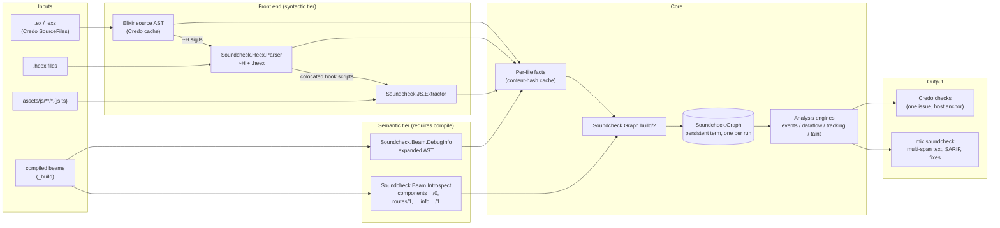

# soundcheck architecture

Status: implemented. Written 2026-10-09 as the pre-implementation design; updated 2026-10-12. Section 3 shows the current module layout. Later sections record the design as decided, and the implementation does not yet include every planned part (the dataflow engine, taint analysis, autofixes, the disk cache).

soundcheck is a Credo plugin that links a Phoenix LiveView application's Elixir callbacks, HEEx templates, and JavaScript hooks into one semantic graph per run, then checks the contracts between them. This document fixes the architecture so implementation can start with phase 1: the HEEx parser and the event-contract rules.

Verification baseline. Claims about Credo were checked against the Credo 1.7.19 source. Claims about LiveView were checked against LiveView 1.2.12 and 1.1.30 and Phoenix 1.8.15. Claims about `debug_info` were checked by decoding a compiled LiveComponent beam under Elixir 1.20.4 / OTP 29. Anything marked **[private]** relies on undocumented or `@moduledoc false` behaviour. Every claim flagged unverified in the first draft was checked on 2026-10-09 and the text now states the result: Phoenix 1.8.15, phoenix_ecto 4.7.0, Sobelow 0.16.0, Expert v0.1.11, ElixirLS v0.31.1, Hex package metadata, and the corpus repositories' default branches.

---

## 1. Summary

soundcheck finds bugs that live between files: a template emits an event no handler accepts, a template reads an assign that the first render never sets, a hook pushes an event to a LiveView that ignores it. It reports only what it can prove. When the analysis cannot resolve something, it marks the finding unverifiable and hides it unless the user asks for strict mode.

### Goals

1. Catch cross-file LiveView contract violations before they crash a LiveView process in production.
2. Adopt in one line of `.credo.exs`, and run inside the existing `mix credo` workflow and its editor integrations.
3. Keep false positives low enough that teams leave default rules enabled. A default-on rule must show at most 2% false positives on the evaluation corpus (section 11).
4. Degrade gracefully: the syntactic tier works on uncompiled or broken code; the semantic tier emits one configuration diagnostic when the project isn't compiled.
5. Support LiveView 1.1 and 1.2 from the first release.

### Non-goals

1. **General Elixir style.** Credo owns that.
2. **General Phoenix security.** Sobelow owns it. soundcheck covers only LiveView-shaped holes: event-param taint and unauthenticated live routes. Sobelow 0.16 already scans `raw/1` in `.html.heex` files and inline `~H` (`XSS.Raw`), so soundcheck has no raw-output rule.
3. **Ash authorization.** ash_credo owns `authorize?: false`, missing actors on Ash calls, and policy checks. soundcheck treats actor-scoped Ash calls as authorized sinks and never reports on Ash calls themselves.
4. **Anything LiveView or Phoenix.Component already reports at compile time.** That includes missing required attrs, undefined attrs, undefined slots, attr value and type mismatches, `phx-hook` or `phx-update` without `id` on HTML tags, invalid `phx-update` values, and variables from the caller's scope used in templates. Section 7.3 lists these exclusions with their LiveView source locations.
5. **Formatting.** `mix format` with `Phoenix.LiveView.HTMLFormatter` owns layout. Autofixes hand off to it.
6. **Full JavaScript analysis.** soundcheck extracts hook registrations and event calls, nothing else.
7. **Type inference.** soundcheck tracks assign keys and taint, not value types. Elixir's type checker owns types.
8. **Editor servers and runtime instrumentation.** soundcheck is static analysis only. It ships no LSP server; editors see its findings through their existing Credo integrations. It ships no runtime companion; no rule depends on telemetry or observed traffic (decision D6).

---

## 2. Architecture overview

**Decision:** one engine, two front doors. The Credo plugin builds the graph once in a pipeline task that runs before any check. Checks then read it concurrently from a persistent term. The standalone `mix soundcheck` task drives the same engine directly.



### Data flow

1. **Init.** `Soundcheck.init/1` (the Credo plugin callback) starts the cache owner, clears the previous run's tables, registers the default config, and inserts `Soundcheck.Credo.BuildGraphTask` at the front of the `:run_analysis` group of the `suggest` and `diff` command pipelines.
2. **Discover.** The build task takes Credo's loaded source files from `Credo.Execution.get_source_files/1`. It then finds `.heex` files through `embed_templates` calls and LiveView colocation conventions, and JavaScript files through the `js_paths` plugin parameter.
3. **Parse.** Each file is parsed in parallel into per-file facts. Facts are cached by content hash, in memory and on disk under `_build/<env>/soundcheck/`.
4. **Enrich.** If the project is compiled, the builder reads expanded ASTs from `debug_info` chunks and probes compiled modules with `__components__/0`, `Phoenix.Router.routes/1`, and `__info__/1`.
5. **Link.** The builder resolves component call sites, event emitters to target modules to handler clauses, hook usages to hook definitions, and routes to LiveViews. Every edge records whether it is resolved or unverifiable, and why.
6. **Analyze.** Rules query the graph. Each rule runs once per run, in its check's `run_on_all_source_files/3`, which Credo calls once per check. The adapter files each diagnostic as an issue on its anchor file.
7. **Report.** Credo renders issues the usual way. `mix soundcheck` renders the full multi-span diagnostics, writes SARIF, applies fixes, and compares against the baseline.

---

## 3. Package and module layout

**Decision:** one Hex package, `soundcheck`. Rule logic and the Credo check adapter live in the same module, so a rule has exactly one home. The package carries no NIFs.

```
lib/
  soundcheck.ex                          # Credo plugin: init/1, default config
  mix/tasks/
    soundcheck.ex                        # mix soundcheck: text, JSON, SARIF, baseline
    soundcheck.install.ex                # Igniter installer
  soundcheck/
    application.ex                       # starts Soundcheck.Cache and Soundcheck.Once
    cache.ex                             # run cache: ETS table, persistent terms for shared values
    once.ex                              # compute-once-per-key with waiters
    config.ex                            # reads settings from .credo.exs
    checks.ex                            # every check, for Credo, mix soundcheck, and the README table
    name_filter.ex                       # atom | Regex matching (ash_credo)
    path_filter.ex                       # excluded_paths matching (ash_credo)
    suppression.ex                       # soundcheck:disable comments (Elixir, HEEx, JS)
    baseline.ex                          # fingerprints of accepted findings
    runner.ex                            # drives the engine for mix soundcheck

    span.ex                              # %Span{file, start: {l, c}, stop: {l, c}}
    line_index.ex                        # byte offset -> {line, column}
    diagnostic.ex                        # %Diagnostic{} multi-span
    rule.ex                              # Soundcheck.Rule behaviour
    check.ex                             # `use Soundcheck.Check` (Credo adapter)

    elixir/
      sigils.ex                          # finds ~H, computes body offset maps
      module_index.ex                    # defmodule, use, kinds from source
      names.ex                           # module names and aliases
    heex/
      lexer.ex                           # error-tolerant HEEx lexer
      parser.ex                          # tree builder
      node.ex                            # node structs
      template.ex                        # %Template{}: one .heex file or ~H sigil
      offset_map.ex                      # body offset -> file {line, col}
      expr.ex                            # re-parses embedded expressions
      reads.ex                           # @assign reads
      walker.ex                          # traversal with lexical context
    js/
      lexer.ex                           # JS/TS lexer (strings, templates, comments, regex)
      extractor.ex                       # hooks, pushEvent*, handleEvent, LiveSocket
    beam/
      debug_info.ex                      # :beam_lib + :elixir_v1 backend
      introspect.ex                      # __components__/0, __info__/1, routes
    graph.ex                             # builds the per-run graph, query API
    graph/
      input.ex                           # one parsed Elixir source
    analysis/
      events.ex                          # event emitters and their receivers
      handlers.ex                        # callback clauses from compiled modules
      hooks.ex                           # JS hook registry, usages, pushed events
      components.ex                      # call site -> definition
      live_modules.ex                    # source modules paired with compiled forms
      assigns.ex                         # assign keys callbacks set (abstract interpretation)
      assign_use.ex                      # assign writes and reads per module
      component_assigns.ex               # keys a function component assigns
      streams.ex                         # stream reads and containers
      mount_hooks.ex                     # on_mount hooks before the first render
      navigation.ex                      # push_patch / navigate targets
      routes.ex                          # paths matched to router routes
      calls.ex                           # remote calls in function bodies
      anchors.ex                         # Credo anchor for template findings
      suggest.ex                         # edit-distance suggestions
    output/
      text.ex                            # multi-span terminal rendering
      sarif.ex
      json.ex
    credo/
      build_graph_task.ex                # Credo.Execution.Task, prepended to :run_analysis
      clear_cache_task.ex                # appended to :halt_execution

    check/
      warning/unhandled_event.ex         # Soundcheck.Check.Warning.UnhandledEvent
      warning/unhandled_async_result.ex
      ...                                # one module per rule (section 7)
```

### Key behaviours

```elixir
defmodule Soundcheck.Rule do
  @type confidence :: :high | :medium | :low
  @type tier :: :syntactic | :semantic

  @callback id() :: String.t()                          # "SC101"
  @callback confidence() :: confidence()
  @callback tier() :: tier()
  @callback requires() :: [{atom(), Version.requirement()}]   # e.g. [phoenix_live_view: ">= 1.1.0"]
  @callback analyze(Soundcheck.Graph.t(), params :: keyword()) :: [Soundcheck.Diagnostic.t()]
  @callback fixes(Soundcheck.Diagnostic.t(), Soundcheck.Graph.t()) ::
              [Soundcheck.Fix.t()]
  @optional_callbacks fixes: 2
end
```

`use Soundcheck.Check` injects `use Credo.Check` with the rule's Credo options and overrides `run_on_all_source_files/3`, which Credo calls once per check and run:

```elixir
def run_on_all_source_files(exec, source_files, params) do
  Soundcheck.Check.run_on_all(__MODULE__, exec, source_files, params)
end
```

`run_on_all/4` does four things:

1. It computes the rule's diagnostics for the whole project.
2. It drops diagnostics that are suppressed, unverifiable in non-strict mode, in `excluded_paths`, or present in the baseline.
3. It keeps the diagnostics anchored in `source_files`, which Credo has narrowed to the files the check covers, plus the anchorless JavaScript ones.
4. It converts each diagnostic to a `Credo.Issue` with `format_issue/3` and appends the issues to the exec.

The generated `run/2` does the same for one file and returns the issues. Credo never calls it; tests and other callers that hold a single source file do.

Each check declares its metadata once, in its `use` options: `:confidence`, `:tier`, `:default`, and `:summary`. The macro generates the matching `Soundcheck.Rule` callbacks, appends the confidence and tier sentence to the Credo explanation, and documents the shared `excluded_paths` and `strict` params. `Soundcheck.Checks` lists the check modules only. `mix lint.readme_checks` fails when the README's check table differs from that metadata, and `--write` regenerates it.

`use Soundcheck.CompiledCheck` adds the ash_credo `CompiledCheck` guard on top. When the project isn't compiled, it emits one configuration diagnostic per run across all semantic checks. When a specific module can't be loaded, it emits one "could not load" issue per module per run.

---

## 4. Front end

**Decision:** soundcheck owns its HEEx parser and its JavaScript extractor. Both are pure Elixir and error-tolerant. Elixir source comes from Credo's cached AST. Expanded AST comes from `debug_info`.

### 4.1 Elixir source

- **Source.** `Credo.SourceFile.ast/1` returns the AST that Credo already parsed and cached in ETS, keyed by content hash. Credo parses with `columns: true, token_metadata: true` (Credo `code.ex:86-94`). soundcheck never re-parses `.ex` files in Credo mode. The standalone task parses with the same options.
- **Module index.** `Soundcheck.Elixir.ModuleIndex` records each `defmodule` with its file, line range, `use` calls, `embed_templates` calls, function heads with their spans, `attr`/`slot` declarations, and `~H` sigils.
- **Kind detection, syntactic tier.** A module counts as a LiveView or LiveComponent when it calls `use Phoenix.LiveView` or `use Phoenix.LiveComponent`, or `use <AppWeb>, :live_view | :live_component`, matched by the `live_view_use_patterns` plugin param. Detection by convention alone produces `kind_confidence: :heuristic`.
- **Kind detection, semantic tier.** The builder confirms kind by calling `mod.__live__()` and sets `kind_confidence: :compiled`. `__live__/0` is generated `@doc false` **[private]**. In LiveView 1.2.12 a LiveView returns `%{container, kind: :view, layout, lifecycle: %Phoenix.LiveView.Lifecycle{mount: hooks, ...}, log}` (`phoenix_live_view.ex:463, 490-509`). Each mount hook is a map with `id: {module, arg}` and `function` (`lifecycle.ex:151-158`), which gives the module-level `on_mount` list without parsing source. A LiveComponent returns `%{kind: :component, layout: false}` (`phoenix_live_component.ex:605`).
- **Error tolerance.** Credo already marks unparsable files `:invalid` and excludes them (Credo `load_and_validate_source_files.ex:17-23`). soundcheck treats a module in an invalid file as absent and marks every edge that would touch it unverifiable.

### 4.2 HEEx

**Decision:** an independent, error-tolerant parser in `Soundcheck.Heex`. soundcheck does not vendor or call LiveView's tokenizer at runtime. CI runs differential tests against LiveView's private parser. See decision Q2.

#### Inputs

- `~H` sigils found in the source AST.
- `.heex` files found through:
  - `embed_templates "pattern"` calls in source; the builder evaluates the glob relative to the calling file.
  - the LiveView colocation convention `foo_live.ex` + `foo_live.html.heex`.
  - the `heex_paths` plugin param (default `["lib/**/*.heex"]`) for files neither mechanism reaches. A template reached only this way gets no owner module and contributes only syntactic facts.

#### Node model

```elixir
defmodule Soundcheck.Heex.Node do
  # Every node carries a span in absolute file coordinates.
  defmodule Element,   do: defstruct [:tag, :kind, :span, :open_span, attrs: [], children: [], close: :normal]
  #   kind: :html | :local_component | :remote_component | :slot
  #   close: :normal | :self | :void | :missing        (:missing only from error recovery)
  defmodule Attr,      do: defstruct [:name, :value, :span, :name_span]
  #   value: {:string, binary, delimiter, value_span}
  #        | {:expr, Macro.t() | {:error, term}, source :: binary, expr_span}
  #        | nil                                          (bare attribute)
  #   name: binary | :root                                ({@rest}, name_span nil)
  defmodule Text,      do: defstruct [:value, :span]
  defmodule BodyExpr,  do: defstruct [:ast, :source, :span]          # {expr}
  defmodule Eex,       do: defstruct [:ast, :source, :span, :marker] # <%= %> / <% %>
  defmodule EexBlock,  do: defstruct [:head, :clauses, :span, :marker, close: :normal]
  #   head: %{ast, source, span}        <%= if ... do %>, parsed with a synthetic `end`
  #   clauses: [%{source, span, children}]   head clause first, then else / `pattern ->`
  defmodule Comment,   do: defstruct [:value, :span, :kind]          # :html | :eex
  defmodule Error,     do: defstruct [:message, :span]               # in Template.errors
end

defmodule Soundcheck.Heex.Template do
  defstruct [
    :id,            # {file, start_position}
    :file,
    :origin,        # :sigil | :file
    :owner,         # {module, fun} | nil
    :root,          # [Node.t()]
    :hash,          # sha256 of the template source, for caching
    errors: []      # [Node.Error.t()]
  ]
end
```

Special attributes (`:for`, `:if`, `:let`, `:key`) stay ordinary attributes. Their expression AST already holds the generator, condition, or pattern, so analyses read them from `Attr.value` without a second representation.

`<script :type={Phoenix.LiveView.ColocatedHook} name=".X">` and `ColocatedJS` script bodies are handed to the JavaScript extractor with their spans, so those body positions map back to the HEEx file.

#### Algorithm

1. **Lex.** The lexer handles text, tags, attributes, `{...}` body and attribute expressions, and EEx markers. Every scanning rule mirrors LiveView's tokenizer, so both split any template LiveView accepts the same way:
   - An expression ends at the `}` that balances the opening `{`. Braces count everywhere, including inside Elixir strings, and only the escapes `\{` and `\}` are skipped (1.2 `tokenizer.ex:655-688`). The first implementation skipped strings and character literals; the differential test showed LiveView reads `{"}"}` as the expression `"`, so a string-aware scanner disagrees exactly on templates that fail to compile anyway.
   - `<script>` and `<style>` bodies are raw text, but EEx tags inside them still become expressions, because LiveView runs `EEx.tokenize/2` before its HTML tokenizer.
   - `phx-no-curly-interpolation` disables `{` interpolation until a tag-depth counter returns to zero. The counter increments on every `>`-terminated open tag, void elements included, and decrements on every closing tag, as LiveView's `push_braces`/`pop_braces` do.
   - EEx expressions are grouped into blocks the way EEx does: an expression ending in `do` or `fn ... ->` opens a block, `else`/`catch`/`rescue`/`after` or a clause ending in `->` continues it, and `end` closes it.
2. **Parse.** A stack-based tree builder runs with recovery, recording an `Error` in `Template.errors` each time:
   - An element still open at end of input, at an outer closing tag, or at an EEx clause boundary closes with `close: :missing`.
   - A closing tag that matches no open element (within the current EEx clause) is dropped.
   - An EEx middle or end expression outside a block is dropped; a block still open at end of input closes with `close: :missing`.
   - An unterminated `{` expression or `<%` tag ends lexing at that point; the nodes before it stay intact.
3. **Re-parse expressions.** The parser runs `Code.string_to_quoted(source, line: l, column: c, columns: true, token_metadata: true)` on every embedded expression in body coordinates, then maps every `line`/`column` in the AST metadata (including nested `closing:`, `do:`, `end:`, and `end_of_expression:` keywords) to file coordinates. `column:` applies to an expression's first line only, so multi-line expressions in indented heredocs need this remapping (verified on Elixir 1.20.4). The first draft used `existing_atoms_only: true` to keep the atom table from growing; that fails on any atom the uncompiled project has not created yet (`@live_action == :edit`), and Credo already creates atoms from source the same way, so the parser does not use it. A failed parse stores `{:error, reason}`; the template stays usable and only that expression is opaque. EEx block heads (`<%= for x <- xs do %>`) are parsed by appending a synthetic `end`, as LiveView's engine does.

**Verification.** `test/soundcheck/heex/differential_test.exs` normalizes both trees (elements, attributes, expressions, EEx blocks; text and comments dropped) and compares them, positions included for `.heex` files and heredoc sigils. On 2026-10-09 it agreed with LiveView 1.2.12's parser on all 706 templates that parser accepts across 13 local applications and LiveView-heavy libraries (LiveDashboard, Oban Web, AshAdmin, ash_authentication_phoenix, live_debugger, Fluxon, Cinder), with zero recovered errors on the soundcheck side. The run against LiveView 1.1's `Tokenizer` is still to do.

#### Span mapping for `~H`

The source AST carries what the mapping needs. Elixir 1.20 produces this for a heredoc sigil (verified):

```elixir
{:sigil_H, [delimiter: ~s("""), line: 3, column: 5, ...],
 [{:<<>>, [indentation: 4, line: 3, column: 5], [body]}, []]}
```

`Soundcheck.Heex.OffsetMap` maps a body position (line and codepoint column within the template string) to file coordinates:

| Sigil form | Body starts at | Line `k` of the body (0-based) |
|---|---|---|
| Heredoc (`"""`, `'''`) | line `meta[:line] + 1` | file line `start + k`; columns shifted by `indentation` (LiveView's tokenizer uses `column_offset = indentation + 1`) |
| Single-line (`"`, `(`, `{`, `[`, `<`, `/`, `\|`, `'`) | line `meta[:line]`, column `meta[:column] + 2 + byte_size(delimiter)` | the same line; multi-line bodies continue at column 1 |

The body binary differs from the source bytes in one case. Uppercase sigils keep escapes verbatim except an escaped closing delimiter, which Elixir 1.20 deprecates (verified warning: "using \\\" to escape the closing of an uppercase sigil is deprecated"). The offset map therefore reads the raw source slice from `Credo.SourceFile.source/1` and records an adjustment wherever it finds `\<delimiter>`. `~H` never interpolates (uppercase sigil), so no `#{}` handling is needed. Column units are UTF-8 codepoints, matching Elixir's own column metadata. SARIF output declares `columnKind: "unicodeCodePoints"`.

`.heex` files use the identity map from line 1, column 1.

#### Version adaptation

The parser accepts the union of LiveView 1.1 and 1.2 syntax. LiveView-version-specific diagnostics stay out of the parser: the 1.2 "missing space before attribute" warning, for example, is LiveView's job.

### 4.3 JavaScript hooks

**Decision:** a pure-Elixir lexer plus a pattern recognizer, not tree-sitter. This deviates from constraint 7; see decision D1. The extractor targets the narrow set of facts in constraint 7. Any construct it cannot resolve makes the affected fact `open` rather than wrong.

Facts:

```elixir
defmodule Soundcheck.JS.Extractor.Facts do
  defstruct file: nil,
            objects: %{},          # brace byte offset => %Object{entries, range, span}
            bindings: %{},         # name => ref           const Hooks = {...}
            member_assigns: [],    # {target, key, ref}    Hooks.Chart = ...; Hooks["Chart"] = ...
            object_assigns: [],    # {target, [ref]}       Object.assign(Hooks, ...)
            imports: %{},          # local => {source, :default | :namespace | name}
            exports: %{},          # :default | name => ref
            live_sockets: [],      # %LiveSocket{hooks: ref | {:options, ref} | nil, span}
            pushes: [],            # %{kind: :push_event | :push_event_to, event, target, offset, span}
            handles: [],           # %{event, offset, span}            this.handleEvent("e", ...)
            window_listeners: []   # %{event, span}                    window.addEventListener("phx:e", ...)
end

# ref:    {:object, id} | {:ident, name} | :other
# entry:  {:key, name, ref} | {:spread, ref} | {:method, name} | :computed
# event:  {:literal, s} | :dynamic          target: :view | :self_el | {:selector, s} | :dynamic
```

The facts are per file and reference nothing outside it. `Extractor.registry/1` resolves the hook names one file registers and returns the reasons the set may be open: `{:import, source, name}` for registries imported from another module (the graph follows those, including `phoenix-colocated/<app>`), or `:dynamic`. `Extractor.events_in/2` returns the pushes and handled events lexically inside one hook object.

1. **Lex.** The lexer covers JavaScript and TypeScript tokens: strings, template literals with nested `${}`, line and block comments, and regex literals. It resolves the regex-versus-division ambiguity by previous-token class, the standard heuristic. TypeScript type annotations pass through as ordinary tokens. JSX is out of scope; the extractor skips `.jsx`/`.tsx` files and records that it did.
2. **Registrations.** The recognizer finds `new LiveSocket(<url>, <Socket>, {... hooks: <expr> ...})`. `<expr>` resolves within the file and one level of relative imports through these forms:
   - an object literal with shorthand, `key: value`, and spreads;
   - an identifier bound by `const`/`let` to an object literal, plus later `X.Name = ...` and `X["Name"] = ...` assignments in the same file;
   - an `import {hooks as colocatedHooks} from "phoenix-colocated/<app>"`, which resolves to the set of colocated hooks found in HEEx (section 4.2). Their names follow LiveView's rule: `"#{inspect(module)}.#{rest}"` for `name=".Rest"` (verified in `colocated_hook.ex:147-166`).
   - Anything else (a computed key, a spread of an unresolved identifier, a function call) sets `open?: true` with a reason.
3. **Hook bodies.** Within each hook object literal, the recognizer collects calls on `this`, or on a variable aliased to `this`, to `pushEvent`, `pushEventTo`, and `handleEvent`. It reads the first string-literal argument as the event name. For `pushEventTo` it also reads the target argument: `this.el` is `{:self_el}`, a string literal is `{:selector, s}`, anything else is `:dynamic`. Payload keys come from an object-literal second argument when one is present.
4. **Window listeners.** The recognizer collects `window.addEventListener("phx:<name>", ...)` as consumers of server `push_event/3`.

Hook and window-listener facts are enough for every JS rule in the catalog. They do not support a JavaScript call graph, and none is planned.

### 4.4 Compiled modules (semantic tier)

#### Expanded AST

`Soundcheck.Beam.DebugInfo.definitions(module)` reads the chunk:

```elixir
{:ok, {^mod, [debug_info: {:debug_info_v1, backend, data}]}} =
  :beam_lib.chunks(beam_path, [:debug_info])
{:ok, %{definitions: defs, file: file, relative_file: rel}} =
  backend.debug_info(:elixir_v1, mod, data, [])
# defs :: [{{name, arity}, :def | :defp | :defmacro | :defmacrop, meta, [{meta, args, guards, body}]}]
```

Verified on a compiled LiveComponent:

- `handle_event/3` clauses arrive with literal patterns intact, e.g. `["validate", %{"product" => product_params}, socket]`.
- Clause metadata carries `line` only. Variable nodes inside patterns also carry `column`, but literals and calls do not, so soundcheck maps a clause back to its source function head by line to recover a column span.
- Calls written as plain functions carry `line` and `column`; macro-expanded calls carry `line` only. `start_async/3` is a macro and expands to `Phoenix.LiveView.Async.start_async/4` without a column; `send/2` expands to `:erlang.send/2` with one (verified). Emitter spans recover a missing column from the source AST: the call with the same name on the same line.
- Expansion rewrites two common handler forms (verified): `"row-" <> id` becomes the binary pattern `<<"row-", id::binary>>`, and `when event in ["a", "b"]` becomes an `:erlang.orelse` chain of `:erlang."=:="(event, "a")` comparisons. Handler matching (6.1.3) reads these expanded forms.
- `render/1` arrives as compiled engine output (`Phoenix.LiveView.Engine` with `changed_assign?/2` calls), not as a HEEx tree. Template structure always comes from the source parser. The engine output is **[private]**, so soundcheck reads nothing from it.

The `:debug_info_v1` chunk is documented by Erlang's `beam_lib`. The `:elixir_v1` backend format is what Elixir tooling (ExDoc, IEx `h`, language servers) relies on, but Elixir does not document it as stable public API. **[private, stable in practice]**

#### Introspection, by dynamic probing (ash_credo pattern)

| Fact | Source | Status |
|---|---|---|
| Function component attrs and slots | `mod.__components__()` returns `%{fun => %{kind, attrs, slots, line}}`, listing only functions that declare at least one `attr` or `slot` (verified) | generated without `@doc false`; the defining module `Phoenix.Component.Declarative` is `@moduledoc false` **[private]** |
| Live routes | `router.__routes__()`, then `metadata.phoenix_live_view = {view, action, opts, %{name, extra}}` | `Phoenix.Router.routes/1` is the public wrapper, but calling it would make Phoenix a soundcheck dependency, so soundcheck reads `__routes__/0` (`@doc false`); the metadata tuple shape is set in `Phoenix.LiveView.Router.__live__/4` (`@doc false`) **[private]**. A route outside any `live_session` reports session `:default` with empty `extra`, indistinguishable by name from an explicit `live_session :default` without hooks (verified); rules read the `on_mount` list, never the session name. |
| Exported callbacks | `mod.__info__(:functions)` | public |
| LiveView/LiveComponent kind, module `on_mount` hooks | `mod.__live__()` returns `:kind` (`:view` or `:component`) and, for views, `lifecycle.mount` | generated `@doc false` **[private]**; shape verified on 1.2.12 |
| Router `pipe_through` | not exposed by `routes/1`, which uses `Map.take` on `[:verb, :path, :plug, :plug_opts, :helper, :metadata]` | soundcheck reads `pipe_through` from router source AST |

Every probe goes through `Soundcheck.Once.run/2` with `Code.ensure_loaded/1` and returns `{:ok, value} | {:error, :not_loadable | :not_applicable}`.

---

## 5. Semantic graph

**Decision:** a typed property graph in a set of named ETS tables owned by `Soundcheck.Cache`, built exactly once per run, before any check runs. Readers do point lookups. Nobody copies the whole graph.

**As implemented (2026-10-12):** `Soundcheck.Graph` is one struct that holds the indexed modules, templates, and JavaScript facts, with maps from module name and template owner for point lookups. `Soundcheck.Once.run_shared/2` stores it as a persistent term, so checks read it without copying (see Q1).

### 5.1 Nodes

```elixir
defmodule Soundcheck.Graph.Nodes do
  defmodule LiveModule do
    defstruct [
      :module, :kind,              # :live_view | :live_component | :component_module | :layout | :router
      :file, :span, :kind_confidence,
      :expanded?,                  # expanded AST available
      :templates,                  # [template_id]
      :handlers,                   # %{handle_event: HandlerSet, handle_info: HandlerSet, handle_async: HandlerSet}
      :on_mount,                   # [{module, arg}] from source `on_mount` + live_session
      :attached_hooks              # [{stage, ref | :dynamic}] from attach_hook/4 calls
    ]
  end

  defmodule HandlerSet do
    defstruct clauses: [], closed?: false, open_reasons: []
    # closed? is true only when clauses come from expanded AST AND no attach_hook
    # targets this stage with an unresolved function.
  end

  defmodule Handler do
    defstruct [
      :module, :callback, :arity,
      :pattern,                    # {:literal, "save"} | {:prefix, "row-"} | :any | {:tuple, ...} (handle_info)
      :required_params,            # map-key tree that the clause pattern requires
      :span, :origin               # :expanded | :source
    ]
  end

  defmodule Emitter do
    defstruct [
      :id,
      :event,                      # {:literal, s} | {:attr, name, call_path} | :dynamic
      :via,                        # :phx_click | :phx_submit | :phx_change | :phx_blur | :phx_focus
                                   # | :phx_keydown | :phx_keyup | :phx_window_* | :js_push
                                   # | :hook_push_event | :hook_push_event_to | :server_push_event
                                   # | :start_async | :send_self
      :target,                     # Target.t()
      :payload,                    # %{keys: [s], form: FormShape.t() | nil}
      :origin,                     # {:template, template_id, element_id} | {:js, file} | {:elixir, mfa}
      :span
    ]
  end

  defmodule Target do
    defstruct [:kind, :modules, :reason]
    # kind: :resolved | :unverifiable
    # modules: [module]              the modules that receive the event
    # reason: atom (see section 6.1.2), for :unverifiable
  end

  defmodule Component do
    defstruct [:module, :fun, :attrs, :slots, :span, :origin]   # origin: :compiled | :source
  end

  defmodule CallSite do
    defstruct [:id, :caller, :callee, :template_id, :span, :attrs, :dynamic?]
    # callee: {module, fun} | {:live_component, module} | {:live_render, module} | :dynamic
    # attrs: %{name => {:literal, term} | {:assign, key} | {:expr, ast}}
  end

  defmodule Hook do
    defstruct [:name, :origin, :def_span, :pushes, :handles, :registered?]
    # origin: :socket | :colocated
  end

  defmodule Route do
    defstruct [:path, :verb, :live_view, :action, :live_session, :on_mount, :pipe_through, :span]
  end

  defmodule AssignSummary do
    defstruct [:mfa, :effect]      # filled in phase 2, see section 6.2
  end
end
```

### 5.2 Edges

| Kind | From → To | Fields |
|---|---|---|
| `:owns_template` | LiveModule → Template | `fun` |
| `:renders` | Template → CallSite → Component / LiveModule | `resolved?` |
| `:emits` | Element or Hook or function → Emitter | — |
| `:targets` | Emitter → LiveModule | `resolution`, `reason` |
| `:handled_by` | Emitter → Handler | `match: :exact \| :prefix \| :catch_all` |
| `:uses_hook` | Element → Hook | `name_literal?` |
| `:routes_to` | Route → LiveModule | — |
| `:subscribes` | LiveModule → Topic | `topic: {:literal, s} \| {:prefix, s} \| :dynamic`, `guarded?` |
| `:reads_assign` | Template → AssignKey | `guard: PathCondition.t()`, `span` |
| `:writes_assign` | function → AssignKey | `may \| must`, `span` |

Every edge whose resolution failed stores `{:unverifiable, reason}`, never a guess.

### 5.3 Storage

**Current implementation (phase 1, first slice).** `Soundcheck.Graph` is a plain struct of per-file facts (indexed modules, templates, JS facts), built once per run through `Soundcheck.Once` and stored as one term in the run cache. Each rule reads it once, when its `run_on_all_source_files/3` computes the diagnostics for the whole project. The multi-table layout below replaces the single term when linking adds edges and the large-app budget (section 12) requires point lookups.

```elixir
defmodule Soundcheck.Graph do
  @type t :: %__MODULE__{generation: reference(), tables: %{atom() => :ets.tid() | atom()}}
  defstruct [:generation, :tables]

  @spec node(t(), id :: term()) :: struct() | nil
  @spec out(t(), id :: term(), edge_kind :: atom()) :: [{to :: term(), props :: map()}]
  @spec into(t(), id :: term(), edge_kind :: atom()) :: [{from :: term(), props :: map()}]
  @spec by_file(t(), Path.t()) :: [id :: term()]
  @spec live_modules(t(), kind :: atom()) :: [LiveModule.t()]
end
```

The store uses four named tables: `nodes` (`:set`), `edges_out` and `edges_in` (`:bag`, keyed `{id, kind}`), and `by_file` (`:bag`). All are `:public` with `read_concurrency: true`.

`:persistent_term` was rejected for node storage (decision Q1). It holds only the soundcheck version string used in cache keys.

### 5.4 Build algorithm

`Soundcheck.Graph.Builder.build(inputs, opts) :: {:ok, Graph.t()}`:

1. **Discover** (section 2, step 2).
2. **Facts, in parallel.** For each file, `Task.async_stream` with `max_concurrency: System.schedulers_online()` loads facts from the content-hash cache or computes them: module index, templates, JS facts. Facts are plain data and never reference other files.
3. **Beam facts, in parallel, semantic tier only.** Applies to LiveModules and component modules. Their keys are `{module, beam_md5}`; `module.module_info(:md5)` gives the md5 for a loaded module, and `:beam_lib.md5/1` gives it for a beam file. Beam facts contain handler clauses, `start_async` names and other emitters found in callback bodies, and attach_hook calls.
4. **Index.** Insert nodes. Build the `module → LiveModule`, `{module, fun} → Component`, and `hook name → Hook` indexes.
5. **Link, in order.** Each step only reads the results of earlier steps, so the build is single-pass and deterministic.
   1. Templates to owners.
   2. Call sites to components. Local `<.foo>` resolves against the owner module and its imports. The builder learns imports from source `import` calls and, in the semantic tier, from `__info__(:functions)` of imported modules.
   3. The render graph: a fixpoint over call sites. For each function component, it computes the set of root live modules that can render it, and the attr bindings along each path (bounded at depth 4).
   4. Emitters to targets (section 6.1).
   5. Targets to handlers.
   6. Hooks.
   7. Routes.
6. **Summaries.** Assign and taint summaries are computed lazily on first query and memoized per `{mfa, beam_md5}`. Phases 2 and 4 add them; phase 1 never pays for them.

### 5.5 Caching and invalidation

| Layer | Key | Lifetime | Invalidated by |
|---|---|---|---|
| Per-file facts (memory) | `{path, sha256(content), soundcheck_vsn, lv_vsn}` | VM | content change |
| Per-file facts (disk) | same key, files under `_build/<env>/soundcheck/facts/` | across runs | content change, version change; LRU cap 200 MB |
| Beam facts | `{module, beam_md5, soundcheck_vsn}` | across runs (disk) | recompile |
| Graph | `generation` reference | one Credo run | cleared in `init/1` and in the `:halt_execution` task (ash_credo double-clear) |
| Rule results | `{rule, params_hash, generation}` | one run | generation change |

The disk cache keeps repeated runs fast (section 12). `mix soundcheck --no-cache` and `rm -rf _build/*/soundcheck` both reset it.

---

## 6. Analysis engines

### 6.1 Event contracts

**Decision:** an emitter is checked only if its event name is literal, its target resolves to a closed set of modules, and every target module has a closed handler set. Everything else is unverifiable.

#### 6.1.1 Emitter extraction

| Source | Event | Target input |
|---|---|---|
| `phx-click`, `phx-submit`, `phx-change`, `phx-blur`, `phx-focus`, `phx-keydown`, `phx-keyup`, `phx-window-*`, `phx-viewport-top/bottom` | string attr value, or `{expr}` | `phx-target` on the element, else on the nearest `<form>` ancestor for form-control `phx-change`/`phx-submit` |
| `JS.push("e", opts)` in any attribute expression, including a `JS` pipeline | first arg | `opts[:target]` |
| Function returning `%JS{}` with a literal push (`def hide(js \\ %JS{}), do: JS.push(js, "close")`) | literal in the function body (expanded AST) | the template call site's context |
| Hook `pushEvent` | JS facts | the view that owns the hook element |
| Hook `pushEventTo` | JS facts | the target argument (6.1.2) |
| `start_async(socket, :name, fun)` | atom literal | the current module's `handle_async/3` |
| `send(self(), msg)`, `Process.send_after(self(), msg, t)` | literal tuple tag or atom | the current module's `handle_info/2` |
| Server `push_event(socket, "e", payload)` | string literal | hook `handleEvent` and `phx:`-prefixed window listeners (reverse direction) |

`phx-change` and `phx-submit` also produce a `FormShape`: the param keys implied by `name` attrs and `<.input field={@form[:x]}>`, nested under the form name when it resolves (6.1.5).

#### 6.1.2 Target resolution

Resolution runs per emitter per render path. A render path is the chain of call sites from a root live module (LiveView or LiveComponent) to the template that contains the emitter. A function component rendered from three LiveViews has three paths, and its emitter must resolve on all of them.

| Situation | Resolves to | Unverifiable when |
|---|---|---|
| No `phx-target` / no `target:` option | the LiveView at the root of the path. Without a target, an event inside a LiveComponent still goes to the parent LiveView. | the path has a dynamic call site (`component(&fun/1)` with a non-literal fun, or `apply`): reason `:dynamic_render_path` |
| `phx-target={@myself}` in a LiveComponent template | that LiveComponent | — |
| `phx-target={@myself}` in a function component | follow `myself` as an attr up the path to the call site that passes it; resolves to the LiveComponent whose `@myself` it is | an attr hop is not a literal `{@myself}` or a forwarded attr: `:dynamic_target` |
| `phx-target={@attr}` (any other attr) | follow the attr up the path (bounded depth 4) to `@myself` or a literal selector | otherwise: `:dynamic_target` |
| `phx-target="#id"` (selector of the form `#literal-id`) | find elements with literal `id="id"` across templates reachable from the same root; the target is the innermost LiveComponent containing the match, else the LiveView | zero or more than one matching element, or the matching id is interpolated: `:ambiguous_selector` |
| `phx-target` with any other selector (class, attribute, compound) | — | always: `:css_selector` |
| `JS.push(..., target: x)` | same rules as `phx-target` with `x` | same |
| Hook `pushEvent` | the LiveView at the root of every path rendering an element with that `phx-hook`. `pushEvent` targets the view even inside a LiveComponent. | `phx-hook={expr}` anywhere for that hook: `:dynamic_hook_ref` |
| Hook `pushEventTo(this.el, ...)` | the innermost LiveComponent containing each element with that `phx-hook`, else the LiveView | as above |
| Hook `pushEventTo("#id", ...)` | selector rules | selector rules |
| Hook `pushEventTo(expr, ...)` | — | always: `:dynamic_target` |
| Event name `{expr}` that is an attr forwarded up the path | the literal at the call site, per path | not literal at the call site: `:dynamic_event` |
| Event name any other expression (`@action`, `"del-" <> id`) | — | always: `:dynamic_event` |
| `live_render(@socket, Child, ...)` | starts a new root at `Child`; events inside `Child`'s templates target `Child` | — |
| Element in the root layout (outside the LiveView container) | — | skipped: not an emitter |

A target counts as resolved only when every render path of the emitter resolves to a non-empty module set, and the render graph above the emitter is closed. The graph is closed when every template on the path has a known owner and every function component on the path has every caller known. Components in dependencies (for example a UI library) that render emitters are analyzed through their source if it is in `deps/` and readable. Otherwise the emitter is unverifiable with reason `:external_component`.

**Implemented (phase 1).** `Soundcheck.Analysis.Events` resolves no-target and `@myself` emitters along render paths, through function components and LiveComponents to the root LiveView. `Soundcheck.Analysis.Components` resolves call sites through the caller's compiled module: its expanded AST renders each function component as `Phoenix.LiveView.TagEngine.component(&Mod.fun/1, ...)`, which names components imported through `use MyAppWeb, :live_view` that source cannot see. `<.live_component module={Mod}>` resolves through the alias-expanded `module` attribute. `Events.expand/3` resolves event names forwarded through component attrs (`phx-click={@event}` with `<.icon_button event="save">`) per call site, up to three levels, and reports a mismatch at the caller's literal. Not yet implemented: forwarded targets, and `#literal-id` selector targets, which are reported as unverifiable (`:css_selector`) until then.

#### 6.1.3 Handler matching

- **Clause patterns** come from expanded AST:
  - A literal binary is `{:literal, s}`.
  - `"prefix" <> _` is `{:prefix, "prefix"}`.
  - A variable or `_` is `:any`. A catch-all clause matches every event, so `UnhandledEvent` cannot fire for that module, and `UnusedEventHandler` treats the catch-all as used.
  - Guards on the event argument (`when event in ["a", "b"]`) expand into literals when the guard is an `in` over a literal list. Any other guard makes the clause `:any`.
- **Attached handlers.** An `on_mount` hook or callback that calls `attach_hook(socket, name, :handle_event, fun)` with a captured local or remote function in the project adds that function's clauses to the handler set. Any other `fun` sets `closed?: false` with reason `:attach_hook_dynamic`.
- **No `handle_event/3` at all.** If the module has no `handle_event/3` and no attached handler, the set is closed and empty. Any resolved emitter is then a definite crash.

**`UnhandledEvent` fires when** the emitter is resolved, at least one target module has a closed handler set, and no clause in that set matches. On a multi-path emitter, the message names each unhandled module.

**Suggestions.** `Soundcheck.Analysis.Suggest` computes Damerau-Levenshtein distance against every literal and prefix event in the target's handler set. It suggests the best match within `max(1, div(String.length(name), 4))` edits, and breaks ties by `String.jaro_distance/2`. Elixir ships `jaro_distance` and `bag_distance` but no Levenshtein, so soundcheck implements Damerau-Levenshtein itself (about 30 lines, banded).

#### 6.1.4 Dead handlers

`UnusedEventHandler` fires for a literal or prefix clause when three conditions hold:

1. The module's emitter set is complete: no unverifiable emitter targets this module, and no unverifiable emitter has this module in its possible-target superset.
2. No literal emitter in any template or hook matches the clause.
3. No string literal equal to the event name appears anywhere in the project's Elixir source outside handler heads. Event names passed through assigns or helpers would otherwise produce false positives.

Condition 1 rules out most real apps that use `phx-click={@action}` patterns. This rule is deliberately opt-in and medium confidence.

#### 6.1.5 Form fields versus handler patterns

**Decision:** report only the direction that crashes. A handler clause whose pattern requires a param key that no resolved form field produces raises `FunctionClauseError` at runtime. A field that no handler consumes is harmless, so soundcheck ignores it.

The form shape resolves when the `<.form>`/`<form>` has a literal `as:` or `phx-submit` form name. For `for={@form}`, it resolves when dataflow (phase 2) traces `@form` to `to_form(x, as: "literal")`, or to `to_form(changeset)` where the changeset's schema module is known. phoenix_ecto 4.7.0 names a changeset form by the `:as` option, or else by the last segment of the data struct's module, underscored: `MyApp.Accounts.User` becomes `"user"` (`phoenix_ecto/html.ex:3-8, 323-328`). A changeset whose data is not a struct and has no `:as` raises, so it never reaches a rendered form. `to_form(map)` without `:as` produces a form with a `nil` name, and its params arrive un-nested (`phoenix_component.ex:1646-1649`). Fields resolve from literal `name="a[b]"`, from `<.input field={@form[:x]}>`, and from `inputs_for` with literal field atoms. Any dynamic `name`, `{@rest}` on an input, or unknown component in the form makes the shape open, and the rule does not fire.

Form `phx-change` always adds `"_target"` and may add `_unused_<name>` keys (verified in `view.ts:1981, 2115`), so patterns that match those never count as unmatched.

#### 6.1.6 Async pairs

`start_async(socket, :name, ...)` in a module requires a `handle_async(:name, ...)` clause, or a catch-all, in the same module. A missing clause crashes when the task finishes. Names are atoms in practice, so matching is exact.

**Blind spots:**

- Event names built at runtime.
- Hooks registered through code soundcheck cannot resolve.
- Handlers attached by dependencies that use `attach_hook` with closures.
- Templates rendered by `Phoenix.Template.render` of dynamic names.

**False-positive risks and mitigations:**

| Risk | Mitigation |
|---|---|
| A library component forwards `phx-*` attrs through `:global` `{@rest}` | `{@rest}` never produces emitters on its own. Emitters come from the call site's literal attrs, resolved to the caller's context. |
| The same function component is used inside and outside LiveComponents | per-path resolution |
| Handler injected by `use MyApp.Live.Table` | expanded AST includes it |
| Project not compiled | `UnhandledEvent` is a semantic check, so it emits the configuration diagnostic only and runs no source-based guessing |

### 6.2 Assign dataflow

**Decision:** an abstract interpretation over expanded AST with a three-valued per-key lattice. It is path-sensitive only on `connected?/1` and on `live_action`, the two splits that drive real render differences. Anything else joins. Unknown socket transformations make the state `open`, which suppresses findings rather than producing them.

#### Lattice

```elixir
@type presence :: :unset | :set | :maybe          # join(:set, :unset) = :maybe
@type state :: %{keys: %{atom() => presence}, open?: boolean(), open_reasons: [term()]}
```

Two facts keep this tractable:

1. **Keys only grow.** LiveView has no API to remove an assign key. `assign(socket, :k, nil)` sets `k`. As a result, the set of definitely-set keys after a callback is a superset of the set before it.
2. **The first render is the critical one.** A template read `@k` raises `KeyError` if `k` is unset at any render. Because keys only grow, the earliest render after `mount` (plus `handle_params` for routed LiveViews) is the weakest point. Later callbacks only matter when they are the sole writer of a key that the template reads.

#### Contexts and transfer functions

The interpreter evaluates, per LiveView and for each context `{connected? :: boolean, live_action :: atom | :any}`, the sequence `on_mount hooks → mount/3 → handle_params/3`. It takes `live_action` values from the routes that point to the module.

- `assign(s, :k, v)`, `assign(s, k: v, ...)`, `assign_new(s, :k, f)`, `assign_async(s, :k | [:k], f)` (sets the keys as `AsyncResult`), `stream(s, :k, ...)` (sets `streams.k`), `allow_upload(s, :k, ...)` (sets `uploads.k`), `assign_form`-style helpers through summaries: these add the keys as `:set`.
- `update(s, :k, f)` requires `k`; a missing `k` is not reported here.
- Struct or map update on `s.assigns`, or `Map.put` on assigns: `open?: true`.
- **Branches.** `if connected?(socket)` splits by context. `case`/`cond`/`with`/`if` on other conditions joins branches.
- **Returns.** A `{:ok, socket}` return contributes its socket state to the result. Raising branches contribute nothing.
- **Local and project function calls** that take and return a socket apply that function's memoized summary. A summary is a map from entry state to exit effects: `must_set`, `may_set`, and `open?`. Summaries are computed bottom-up over the project call graph. Recursion is cut at depth 3, which yields `open?`.
- **Calls outside the project** (dependencies) that return a socket: `open?: true`.
- **`on_mount` hooks.** Hooks come from the `live_session` metadata on routes and from `on_mount` in the module. soundcheck analyzes each hook's `on_mount/4` clause for the given arg the same way, taking only `{:cont, socket}` returns. A `{:halt, socket}` path never renders, so soundcheck drops it.

LiveComponents use the sequence `mount/1 → update/2 or update_many/1 → render`. The default `update/2` assigns everything passed at the call site. The keys set at entry are therefore the intersection of literal attr names across all resolved `<.live_component module={M}>` call sites, plus `:id`, `:myself`, and `:flash`. An unresolved call site makes the component open.

#### Template reads

`Soundcheck.Analysis.Dataflow.TemplateReads` walks each template and records every `@k` read (`assigns.k` too) with its path condition:

- the conjunction of enclosing `:if`, `if`/`unless`/`case` on `@live_action == :lit` or `@live_action in [...]`;
- enclosing truthiness guards on other assigns (`:if={@user}` before `@user.name`);
- slot and `:let` scopes, which shadow `@`-reads of slot args.

Reads under a guard that the context refutes (for example `@live_action == :edit` in context `live_action: :new`) are excluded for that context. Reads through `assigns[:k]` and `Map.get(assigns, :k)` are safe by construction and never reported.

#### Findings

| Rule | Condition |
|---|---|
| `PossiblyUnsetAssign` | some context, not `open?`, has `k` as `:unset` or `:maybe` at first render, and the template reads `@k` unguarded in that context |
| `AssignSetOnlyWhenConnected` | `k` is `:set` in the connected context and `:unset` in the disconnected context, and is read unguarded. This is the high-confidence special case: the disconnected (HTTP) render crashes. |
| `UnreadAssign` | a key is written somewhere and read nowhere: no template read, no `socket.assigns.k` / `socket.assigns[:k]` in the module, its components, or `on_mount` hooks, and not passed to a layout (`@k` reads in layouts count for every LiveView using that layout) |
| `UndeclaredComponentAttr` | a function component with at least one `attr` declaration reads `@k` where `k` is not declared as an attr or slot, is not set by `assign(assigns, ...)` in the component body before the `~H`, and is not one of `inner_block`, `rest`, `__changed__`, `__given__`. Syntactic. |
| `OptionalAttrWithoutDefault` | `attr :k, ..., required: false` with no `:default`, read as `@k` unguarded. A caller that omits `k` triggers a `KeyError`. Verified: the generated component wrapper merges only attrs that declare `:default` (and optional slots, as `[]`) into `assigns` (`declarative.ex:653-679`), and the engine compiles `@k` to `assigns.k` (`engine.ex:1053-1056`). |
| `StreamCandidate` | a list assign is read by a `:for` in a template and is updated in `handle_event`/`handle_info` by prepend or append (`update(s, :k, &[x \| &1])`, `&1 ++ [x]`) |
| `TemporaryAssignCandidate` | a list assign is replaced in every write and only read once in a `:for`. Low confidence. |

**Precision:** sound for direct `assign` calls. It under-approximates "set" when helpers come from dependencies (handled by `open?`, which never reports). Path sensitivity covers only `connected?` and `live_action`; any other split joins to `:maybe`, which is why `PossiblyUnsetAssign` ships off by default and is promoted only on corpus evidence.

**Blind spots:** assigns set by `attach_hook(:handle_params)` closures. LiveComponents rendered through dynamic `module={@mod}`. Layout assigns set in plugs and passed through the session.

**False-positive risks:** templates that guard with helper functions (`:if={show?(@x)}`) are treated as unconditional, which the `PossiblyUnsetAssign` default-off status covers. `assign_new` fed from the session in `on_mount`, which the `on_mount` analysis covers.

### 6.3 Change tracking and streams

**Decision:** purely syntactic rules over the HEEx tree and function bodies. They are cheap, precise, and run without compilation. LiveView already warns about caller-scope variables in templates (`engine.ex:1314-1342`), so soundcheck covers only what LiveView leaves silent.

| Rule | Detection |
|---|---|
| `BareAssignsInTemplate` | inside a template expression, a call that passes the bare `assigns` variable to any function, or `{assigns}`/`{@rest = assigns}` spreading. LiveView silently disables tracking for these (verified: "using `assigns` directly gives no warning", `engine.ex:1134`). Excluded: the `assigns` first arg of `render_slot/2`-like LiveView functions, from a fixed list. |
| `AssignsDotAccess` | `assigns.k` in a template expression. This is a consistency rule, not a change-tracking rule: LiveView 1.1 and 1.2 track `assigns.k` and `assigns[:k]` exactly like `@k` (1.2 `engine.ex:1059-1080`). The rule ignores `assigns[:k]`, because it returns `nil` for a missing key where `@k` raises, so the two are not interchangeable. |
| `TemplateBoundVariable` | `<% x = @foo %>`, or `{x = ...}`, binding a variable inside a template that a later expression reads. Verified on 1.2: LiveView warns only when the variable exists in the caller env (`maybe_warn_taint/3` checks `Macro.Env.has_var?/2`, `engine.ex:1309-1311`). A template-local binding outside `:for`/`:let`/control-flow scopes silently taints the expressions that read it (`engine.ex:1166-1181`). |
| `StreamContainerWithoutPhxUpdate` | `:for={{dom_id, x} <- @streams.k}` whose parent element lacks `phx-update="stream"`. LiveView checks this only client-side in debug mode (`utils.ts:53-76`). |
| `StreamChildWithoutId` | a direct child of a `phx-update="stream"` container without `id={dom_id}` (any id expression counts), or a component child. Literal ids also fire, because a literal id repeats for every item. LiveView reports this only at runtime in JS (`dom.ts:750`). |
| `StreamConsumedOutsideFor` | `@streams.k` used anywhere other than a `:for` generator or `for` comprehension. LiveView raises at runtime (`live_stream.ex:109`). |
| `ExpensiveCallInTemplate` | a template expression that calls a configured expensive module (`Repo`, `Ecto.Query`, `Enum.sort*`, `Enum.group_by`), re-evaluated whenever its assign dependencies change |
| `StreamCandidate` | section 6.2 |

### 6.4 Security taint

**Decision:** an interprocedural forward taint analysis over expanded AST. Sources are event and route params. Sinks are Ecto `Repo` calls. Sanitizers are data that flows from the current scope or user. Ash calls with `actor:`, `scope:`, or `tenant:` count as authorized sinks. Ash calls without them are ignored, because ash_credo owns them. The rule ships opt-in and medium confidence.

- **Sources.** Bindings from the params argument of `handle_event/3` and `handle_params/3` (pattern-bound variables and `params["k"]` reads), and `uri` in `handle_params/3`.
- **Propagation.** Through variable binding, string and number conversions (`String.to_integer/1`, `Integer.parse/1`), map access, pipes, and `Ecto.Query` macros (`from`, `where`, `^pinned`). Through project functions via summaries `param_index → [sink | return]`, memoized per beam.
- **Sinks.** `Repo.get/get!/get_by/get_by!/one/one!/all/update/update!/delete/delete!/delete_all/update_all/insert*` on modules matching the `repo_modules` param (default: modules that `use Ecto.Repo`, probed through `__adapter__/0` presence). A sink is tainted when a tainted value reaches its queryable, its id, or its clauses.
- **Sanitizers (authorization evidence).** Any of these on the path from source to sink, or in the same call:
  1. A value derived from `socket.assigns.<k>` for `k` in `scope_assigns` (default `[:current_scope, :current_user]`) flows into the same sink call or query. This covers the Phoenix 1.8 generator's `Context.get_post!(scope, id)` pattern, where the scope is the first argument.
  2. A call to a function matching `authorizers` (default `[Bodyguard, ~r/\.authorize!?$/, ~r/\.can\?$/]`) whose arguments include the tainted value or the loaded record.
  3. After the sink, the loaded record is compared against a scope-derived value in a guard that dominates every use of the record (`if post.user_id == scope.user.id`).
  4. An Ash call with an `actor:`/`scope:`/`tenant:` option, which counts as an authorized sink.
- **Finding.** `UnscopedLookupByClientParam` is anchored at the sink, with the source as a related location and the full path as a SARIF code flow.

| Rule | Detection |
|---|---|
| `LiveRouteWithoutAuthHook` | live route whose `live_session` `on_mount` list contains no hook matching `auth_hooks`, unless its path matches `public_paths`. LiveView's security model requires `on_mount` authentication even when plugs authenticate the HTTP request, because the websocket mount bypasses plugs. Fires only when `auth_hooks` is configured or auto-detected (`MyAppWeb.UserAuth` with `on_mount/4` clauses). |

**Blind spots:** authorization done in `on_mount` and then trusted implicitly (for example, the record loaded in `on_mount` keyed by a route param). Authorization through database row-level security. Queries built in dependencies.

**False-positive risks:** admin LiveViews where every user is authorized. Mitigation: an `excluded_modules` param defaulting to `[~r/Admin/]`, and the rule's off-by-default status.

### 6.5 Lifecycle and process health

| Rule | Detection |
|---|---|
| `UnguardedSubscribe` | `Phoenix.PubSub.subscribe/2,3` or `<App>.Endpoint.subscribe` in `mount/3`, not dominated by `if connected?(socket)`. Syntactic. A function whose name matches `subscribe_functions` (default `[~r/subscribe/]`) counts as the call. |
| `ExpensiveMountWork` | a sink call (`repo_modules`, HTTP clients `Req`/`Finch`/`HTTPoison`/`Tesla`) in `mount/3` reachable in both contexts, with no `assign_async`/`start_async`. Semantic. |
| `SubscribedWithoutHandleInfo` | a module that subscribes but defines no `handle_info/2` at all. High confidence; a broadcast to it crashes the process. The narrower "no clause matches the broadcast shape" check is reserved for a later phase, because broadcasts are usually built in context modules soundcheck doesn't trace. |
| `UnhandledInfoMessage` | `send(self(), msg)` or `Process.send_after(self(), msg, t)` with a literal atom or literal-tag tuple, and no `handle_info/2` clause that can match it |
| `BlockingCallInHandler` | `Process.sleep/1`, `:timer.sleep/1`, `Task.await/1,2` without a timeout under 1 second, `receive` without `after`, or an HTTP client call inside `handle_event/3` or `handle_info/2` |

### 6.6 Navigation

| Rule | Detection |
|---|---|
| `PatchToForeignLiveView` | `push_patch(socket, to: ~p"/x")`, where the verified-route literal (static segments only, dynamic segments as wildcards) matches a live route to a different LiveView than the current module. LiveView raises at runtime for a server-side patch; a client-side `<.link patch>` falls back to navigation instead, so the check skips it. Semantic, router required. |
| `NavigateAcrossLiveSession` | `<.link navigate={~p"/x"}>` or `push_navigate`, where the current module's routes and the destination route sit in different `live_session`s. This works, but degrades to a full page reload. Opt-in. |

### 6.7 Forms, accessibility, hooks

| Rule | Detection |
|---|---|
| `FormForChangeset` | `<.form for={@k}>`, where dataflow or naming (`k` ends in `changeset`) shows a changeset rather than `to_form/2` output |
| `ChangeWithoutDebounce` | a text-like `<input>`/`<.input type=text\|email\|search\|textarea>` inside a form with `phx-change`, without `phx-debounce` on the input or the form |
| `ClickOnNonInteractiveElement` | `phx-click` on `div`, `span`, `li`, `td`, `tr`, `img`, `p`, or `section`, without `role` and `tabindex`, and without a `phx-keydown`/`phx-keyup` handler |
| `UndefinedHook` | `phx-hook="Name"` (literal), where no registration resolves to `Name` and the registration set is closed. Colocated `phx-hook=".Name"` resolves within the owning module (verified rewrite in `compiler.ex:1157-1171`). |
| `UnusedHook` | a hook registered in `LiveSocket`, never referenced by a literal `phx-hook`, with no dynamic `phx-hook={expr}` anywhere |
| `UnhandledServerPushEvent` | `push_event(socket, "e", _)` with no hook `handleEvent("e")` and no `phx:e` window listener, while the JS facts are closed |

---

## 7. Rule catalog

**Decision:** 36 rules. Phase 1, the launch set (marked ★), contains 9 rules; 4 of them are on by default. A rule is default-on only at confidence `high` and with corpus false positives at or below 2%.

Columns:

- **Pri**: Credo `base_priority`.
- **Tier**: syn (syntactic) or sem (semantic).
- **Conf**: confidence.
- **Fix**: autofix kind.
- **Ph**: delivery phase.

### 7.1 Catalog

| ID | Check module | Category | Pri | Default | Tier | Conf | Fix | Ph |
|---|---|---|---|---|---|---|---|---|
| SC101 ★ | `Soundcheck.Check.Warning.UnhandledEvent` | warning | high | **on** | sem | high | unsafe (rename to suggestion) | 1 |
| SC102 ★ | `Soundcheck.Check.Design.UnusedEventHandler` | design | normal | off | sem | medium | none | 1 |
| SC103 ★ | `Soundcheck.Check.Warning.UnhandledHookEvent` | warning | high | off | sem | medium | none | 1 |
| SC104 ★ | `Soundcheck.Check.Warning.UnhandledAsyncResult` | warning | high | **on** | sem | high | none | 1 |
| SC105 | `Soundcheck.Check.Warning.FormFieldMismatch` | warning | normal | off | syn | medium | none | 2 |
| SC106 ★ | `Soundcheck.Check.Warning.UnhandledServerPushEvent` | warning | normal | off | syn | medium | none | 1 |
| SC107 ★ | `Soundcheck.Check.Warning.UnhandledInfoMessage` | warning | high | off | sem | high | none | 1 |
| SC201 | `Soundcheck.Check.Warning.PossiblyUnsetAssign` | warning | high | off | sem | medium | none | 2 |
| SC202 | `Soundcheck.Check.Warning.AssignSetOnlyWhenConnected` | warning | high | on | sem | high | none | 2 |
| SC203 ★ | `Soundcheck.Check.Warning.UndeclaredComponentAttr` | warning | normal | **on** | syn | high | unsafe (add `attr`) | 1 |
| SC204 | `Soundcheck.Check.Warning.OptionalAttrWithoutDefault` | warning | normal | off | syn | medium | unsafe (add `default: nil`) | 2 |
| SC205 | `Soundcheck.Check.Design.UnreadAssign` | design | low | off | syn | medium | none | 2 |
| SC301 | `Soundcheck.Check.Refactor.BareAssignsInTemplate` | refactor | normal | off | syn | high | none | 3 |
| SC302 | `Soundcheck.Check.Readability.AssignsDotAccess` | readability | low | off | syn | high | safe (`assigns.k` → `@k`) | 3 |
| SC303 | `Soundcheck.Check.Refactor.TemplateBoundVariable` | refactor | normal | off | syn | medium | none | 3 |
| SC304 | `Soundcheck.Check.Warning.StreamContainerWithoutPhxUpdate` | warning | high | on | syn | high | safe (add `phx-update="stream"` when the container has a literal `id`) | 3 |
| SC305 | `Soundcheck.Check.Warning.StreamChildWithoutId` | warning | high | on | syn | high | unsafe (add `id={dom_id}`) | 3 |
| SC306 | `Soundcheck.Check.Warning.StreamConsumedOutsideFor` | warning | high | on | syn | high | none | 3 |
| SC307 | `Soundcheck.Check.Refactor.StreamCandidate` | refactor | low | off | syn | low | none | 3 |
| SC308 | `Soundcheck.Check.Refactor.TemporaryAssignCandidate` | refactor | low | off | syn | low | none | 3 |
| SC309 | `Soundcheck.Check.Refactor.ExpensiveCallInTemplate` | refactor | normal | off | syn | medium | none | 3 |
| SC401 | `Soundcheck.Check.Warning.UnscopedLookupByClientParam` | warning | high | off | syn | medium | none | 4 |
| SC402 | `Soundcheck.Check.Warning.LiveRouteWithoutAuthHook` | warning | high | off | sem | high (when configured) | none | 4 |
| SC501 | `Soundcheck.Check.Warning.UnguardedSubscribe` | warning | normal | on | syn | high | unsafe (wrap in `if connected?(socket)`) | 3 |
| SC502 | `Soundcheck.Check.Refactor.ExpensiveMountWork` | refactor | normal | off | syn | medium | none | 3 |
| SC601 | `Soundcheck.Check.Warning.SubscribedWithoutHandleInfo` | warning | high | on | sem | high | none | 3 |
| SC602 | `Soundcheck.Check.Warning.BlockingCallInHandler` | warning | normal | off | syn | medium | none | 3 |
| SC701 | `Soundcheck.Check.Warning.PatchToForeignLiveView` | warning | high | on | sem | high | unsafe (`patch` → `navigate`) | 3 |
| SC702 | `Soundcheck.Check.Refactor.NavigateAcrossLiveSession` | refactor | low | off | sem | low | none | 3 |
| SC801 | `Soundcheck.Check.Refactor.FormForChangeset` | refactor | normal | off | syn | medium | unsafe (wrap with `to_form`) | 3 |
| SC802 | `Soundcheck.Check.Refactor.ChangeWithoutDebounce` | refactor | low | off | syn | medium | safe (add `phx-debounce="300"`) | 3 |
| SC901 | `Soundcheck.Check.Design.ClickOnNonInteractiveElement` | design | normal | off | syn | high | unsafe (add `role="button" tabindex="0"`) | 3 |
| SC1001 ★ | `Soundcheck.Check.Warning.UndefinedHook` | warning | high | **on** | syn | high | unsafe (rename to suggestion) | 1 |
| SC1002 ★ | `Soundcheck.Check.Design.UnusedHook` | design | low | off | syn | medium | none | 1 |
| SC000 | `Soundcheck.Check.Consistency.Configuration` (diagnostics only) | consistency | normal | on | — | — | none | 1 |
| SC001 | `Soundcheck.Check.Readability.InvalidSuppression` (unknown rule ids, missing reasons in strict) | readability | low | on | syn | high | none | 2 |

Phase 1 defaults: SC101, SC104, SC203, SC1001, plus the SC000 diagnostics. Phase 2 adds SC001 and SC202. Phase 3 adds SC304, SC305, SC306, SC501, SC601, and SC701, subject to the corpus gate; SC301 ships opt-in (D8).

As built, SC105, SC205, SC307, SC308, SC401, and SC502 read source only, so they run on uncompiled projects. SC401 follows taint within one clause; interprocedural summaries remain future work. SC001 does not report unused suppressions: Credo runs each check on its own, so no check sees which directives matched another check's findings.

### 7.2 Must-fire and near-miss examples

Each pair becomes a golden test (section 11). "Fires" must produce exactly one diagnostic at the marked construct. "Near miss" must produce none.

**SC101 UnhandledEvent**
- Fires: `<button phx-click="sav">` in `PostLive.Index`, which defines `handle_event("save", _, s)`. Message suggests `"save"`.
- Near miss: the same button with `phx-target={@myself}` inside `PostLive.FormComponent`, which handles `"sav"`.

**SC102 UnusedEventHandler**
- Fires: `handle_event("archive", _, s)` in a module whose every emitter is literal and none emits `"archive"`.
- Near miss: the module also renders `<.button phx-click={@action}>`, an unverifiable emitter that could target it.

**SC103 UnhandledHookEvent**
- Fires: hook `Chart` calls `this.pushEvent("zoom", {})`; `<div id="c" phx-hook="Chart">` is rendered only by `StatsLive`, which has no `"zoom"` clause.
- Near miss: `this.pushEventTo(this.el, "zoom")` with the element inside a LiveComponent that handles `"zoom"`.

**SC104 UnhandledAsyncResult**
- Fires: `start_async(socket, :load_stats, fn -> ... end)` with only `handle_async(:load_users, ...)` defined.
- Near miss: `handle_async(name, result, socket)` with a variable name, a catch-all.

**SC105 FormFieldMismatch**
- Fires: `handle_event("save", %{"user" => %{"email" => e, "name" => n}}, s)` on a form whose resolved fields are `user[email]` only.
- Near miss: a pattern that requires `"_target"` on a `phx-change` handler.

**SC106 UnhandledServerPushEvent**
- Fires: `push_event(socket, "highlite", %{})` while hooks handle only `"highlight"` and no `phx:highlite` listener exists.
- Near miss: `window.addEventListener("phx:highlite", ...)` in `app.js`.

**SC107 UnhandledInfoMessage**
- Fires: `Process.send_after(self(), :tick, 1000)` and no `handle_info(:tick, s)` clause.
- Near miss: `handle_info(msg, s)` catch-all present.

**SC201 PossiblyUnsetAssign**
- Fires: the template reads `@stats` unguarded; `@stats` is assigned only in `handle_event("refresh", ...)`.
- Near miss: the read sits inside `:if={@live_action == :show}`, and `handle_params` assigns `:stats` on the `:show` action.

**SC202 AssignSetOnlyWhenConnected**
- Fires: `if connected?(socket), do: assign(socket, :user, load()), else: socket`, while the template reads `@user`.
- Near miss: the else branch assigns `user: nil`.

**SC203 UndeclaredComponentAttr**
- Fires: a component with `attr :title, :string` whose template reads `@subtitle`.
- Near miss: the body calls `assigns = assign(assigns, :subtitle, "x")` before `~H`.

**SC204 OptionalAttrWithoutDefault**
- Fires: `attr :icon, :string` (not required, no default) and the template reads `@icon`.
- Near miss: the template reads `:if={assigns[:icon]}`, or the attr declares `default: nil`.

**SC205 UnreadAssign**
- Fires: `assign(socket, :page_size, 20)`, never read anywhere.
- Near miss: read via `socket.assigns.page_size` in `handle_event`.

**SC301 BareAssignsInTemplate**
- Fires: `{format_title(assigns)}` in a template.
- Near miss: `{format_title(@title)}`.

**SC302 AssignsDotAccess**
- Fires: `{assigns.title}` in a template.
- Near miss: `assigns.title` in a function body outside `~H`.

**SC303 TemplateBoundVariable**
- Fires: `<% total = Enum.sum(@items) %>` followed by `{total}`.
- Near miss: `:for={item <- @items}` binding `item`.

**SC304 StreamContainerWithoutPhxUpdate**
- Fires: `<ul id="posts"><li :for={{id, p} <- @streams.posts} id={id}>`.
- Near miss: the `<ul>` has `phx-update="stream"`.

**SC305 StreamChildWithoutId**
- Fires: `<li :for={{_id, p} <- @streams.posts}>` inside a `phx-update="stream"` container.
- Near miss: `<li :for={{id, p} <- @streams.posts} id={id}>`.

**SC306 StreamConsumedOutsideFor**
- Fires: `{length(@streams.posts)}`.
- Near miss: `:for={{id, p} <- @streams.posts}`.

**SC307 StreamCandidate**
- Fires: `update(socket, :messages, &(&1 ++ [msg]))` in `handle_info`, with `:for={m <- @messages}`.
- Near miss: `assign(socket, :messages, list_messages())`, a full replacement.

**SC308 TemporaryAssignCandidate**
- Fires: `assign(s, :log_lines, fetch())` in every writer, rendered once in a `:for`, never read elsewhere.
- Near miss: `@log_lines` also read in `handle_event`.

**SC309 ExpensiveCallInTemplate**
- Fires: `{Repo.aggregate(Post, :count)}` in a template.
- Near miss: `{@post_count}`.

**SC401 UnscopedLookupByClientParam**
- Fires: `handle_event("delete", %{"id" => id}, s)` → `Repo.get!(Post, id) |> Repo.delete()`.
- Near miss: `Blog.get_post!(s.assigns.current_scope, id)`, where the scope flows into the query.

**SC402 LiveRouteWithoutAuthHook**
- Fires: `live "/settings", SettingsLive` inside `live_session :default` with no `on_mount`, while `auth_hooks: [MyAppWeb.UserAuth]` is configured.
- Near miss: the route is in `live_session :authenticated, on_mount: [{MyAppWeb.UserAuth, :require_authenticated}]`.

**SC501 UnguardedSubscribe**
- Fires: `Phoenix.PubSub.subscribe(MyApp.PubSub, "posts")` directly in `mount/3`.
- Near miss: the call inside `if connected?(socket) do ... end`.

**SC502 ExpensiveMountWork**
- Fires: `Repo.all(Post)` in `mount/3`, not in `assign_async`.
- Near miss: `assign_async(socket, :posts, fn -> {:ok, %{posts: Repo.all(Post)}} end)`.

**SC601 SubscribedWithoutHandleInfo**
- Fires: a LiveView subscribes in `mount` and defines no `handle_info/2`.
- Near miss: it defines any `handle_info/2`.

**SC602 BlockingCallInHandler**
- Fires: `Process.sleep(500)` in `handle_event`.
- Near miss: `Process.send_after(self(), :retry, 500)`.

**SC701 PatchToForeignLiveView**
- Fires: `push_patch(socket, to: ~p"/users/#{id}")` from `PostLive.Index`, where `/users/:id` routes to `UserLive.Show`.
- Near miss: `push_patch(socket, to: ~p"/posts/#{id}/edit")`, which routes to `PostLive.Index :edit`.

**SC702 NavigateAcrossLiveSession**
- Fires: `<.link navigate={~p"/admin"}>` from `:default` to `:admin` session.
- Near miss: `navigate` within the same session.

**SC801 FormForChangeset**
- Fires: `<.form for={@changeset}>`.
- Near miss: `<.form for={@form}>` with `assign(s, :form, to_form(cs))`.

**SC802 ChangeWithoutDebounce**
- Fires: `<.input field={@form[:q]} type="search">` in a `phx-change` form with no debounce.
- Near miss: `phx-debounce="300"` on the input.

**SC901 ClickOnNonInteractiveElement**
- Fires: `<div phx-click="open">`.
- Near miss: `<div phx-click="open" role="button" tabindex="0" phx-keydown="open" phx-key="Enter">`.

**SC1001 UndefinedHook**
- Fires: `phx-hook="InfiniteScrol"` while the LiveSocket registers `{InfiniteScroll}`, a closed set. The message suggests `"InfiniteScroll"`.
- Near miss: the registration spreads an unresolved `...ExternalHooks`, so the set is open and the finding is unverifiable.

**SC1002 UnusedHook**
- Fires: `Hooks.Legacy = {...}` registered, never referenced.
- Near miss: a template contains `phx-hook={@hook_name}`.

**SC000 Configuration**
- Fires: a semantic check runs with no `_build` beams for the app.
- Near miss: the project is compiled.

**SC001 InvalidSuppression**
- Fires: `# soundcheck:disable-next-line SC999`.
- Near miss: `# soundcheck:disable-next-line SC101`.

### 7.3 Deliberately not implemented: the framework reports these

| Analysis from the brief | Why soundcheck skips it | LiveView source |
|---|---|---|
| `phx-hook` element without `id` | LiveView raises `ParseError` at compile time on HTML tags | 1.2 `compiler.ex:1209-1214`, 1.1 `tag_engine.ex:1592` |
| `phx-update` without `id` | same | same |
| Missing required / undefined attrs and slots at literal call sites | compile warnings in `Phoenix.Component.Declarative.__verify__/2` | 1.2 `declarative.ex:1144-1284` |
| Caller-scope variables in templates | compile warning "you are accessing the variable ..." | 1.2 `engine.ex:1314-1342` |
| Invalid `phx-update` values, deprecated `append`/`prepend` | compile error / warning | `compiler.ex:1240-1249` |
| `raw/1` fed by assigns | Sobelow 0.16.0 `XSS.Raw` covers `*.html.heex` and inline `~H` (decision D3) | sobelow/sobelow `lib/sobelow/xss/raw.ex:129-134` |

One gap remains: `phx-hook` passed to a function component that forwards it through `{@rest}` onto an element with no `id`. LiveView skips the id check when a root `{@attrs}` is present. This is a candidate for a later medium-confidence rule; it is not in the catalog.

---

## 8. Configuration

**Decision:** ash_credo's parameter conventions apply throughout.

- Matchers accept atoms (exact) or regexes.
- Module names are alias-resolved before matching.
- Most checks take `excluded_paths`, defaulting to `Soundcheck.PathFilter.default_excluded_paths/0` (`[~r"/test/", "test"]`).
- Team conventions are check params, not separate checks.

### 8.1 Plugin params

```elixir
# .credo.exs
%{configs: [%{
  name: "default",
  plugins: [{Soundcheck, [
    strict: false,                         # surface unverifiable findings
    js_paths: ["assets/js"],
    heex_paths: ["lib/**/*.heex"],
    live_view_use_patterns: [~r/Web$/],    # `use MyAppWeb, :live_view`
    baseline: ".soundcheck_baseline.exs",  # nil disables
    cache: true
  ]}]
}]}
```

`Credo.Execution.get_plugin_param/3` reads these (verified, `execution.ex:364`). `Soundcheck.init/1` also registers the CLI switch `--soundcheck-strict` through `Credo.Plugin.register_cli_switch/5` (verified, `plugin.ex:361`).

### 8.2 Per-check params

| Check | Param | Default | Meaning |
|---|---|---|---|
| all | `excluded_paths` | `[~r"/test/", "test"]` | path filter (ash_credo `PathFilter`) |
| all | `strict` | inherits plugin | per-check override |
| UnhandledEvent | `ignore_events` | `[]` | atoms/strings or regexes of event names to skip |
| UnhandledEvent | `suggest_threshold` | `:auto` | `:auto` (len/4) or integer edit distance |
| UnusedEventHandler | `ignore_events` | `[]` | as above |
| UnhandledHookEvent | `ignore_hooks` | `[]` | hook names or regexes |
| UnhandledInfoMessage | `ignore_messages` | `[]` | tag atoms or regexes |
| UndeclaredComponentAttr | `implicit_assigns` | `[:inner_block, :rest, :__changed__, :__given__]` | names never reported |
| PossiblyUnsetAssign | `assume_set` | `[:current_user, :current_scope, :flash]` | keys guaranteed by the team's `on_mount` conventions when analysis can't see it |
| UnreadAssign | `ignore_assigns` | `[:page_title]` | keys read by layouts or by the framework |
| BareAssignsInTemplate | `allowed_functions` | `[render_slot: 2]` | `{name, arity}` or regex on `Mod.fun` |
| ExpensiveCallInTemplate / ExpensiveMountWork | `expensive_modules` | `[~r/\.Repo$/, Ecto.Query, Req, Finch, HTTPoison, Tesla]` | |
| UnscopedLookupByClientParam | `repo_modules` | auto-detected `Ecto.Repo` users | |
| | `scope_assigns` | `[:current_scope, :current_user]` | |
| | `authorizers` | `[Bodyguard, ~r/\.authorize!?$/, ~r/\.can\?$/]` | |
| | `excluded_modules` | `[~r/Admin/]` | |
| LiveRouteWithoutAuthHook | `auth_hooks` | `:auto` | `[{Module, arg_atom_or_regex}]` or modules |
| | `public_paths` | `["/", ~r"^/(log_in\|register\|reset_password)"]` | |
| UnguardedSubscribe | `subscribe_functions` | `[{Phoenix.PubSub, :subscribe}, ~r/\.subscribe$/]` | |
| BlockingCallInHandler | `blocking_calls` | `[{Process, :sleep}, {:timer, :sleep}, Req, Finch, HTTPoison, Tesla]` | |
| ChangeWithoutDebounce | `input_types` | `["text", "search", "email", "textarea"]` | |
| ClickOnNonInteractiveElement | `non_interactive_tags` | `~w(div span li td tr img p section)` | |
| UndefinedHook | `external_hooks` | `[]` | names registered by code soundcheck can't see; adding any makes the set closed again |
| NavigateAcrossLiveSession | `ignore_sessions` | `[]` | |

---

## 9. Diagnostics and output

**Decision:** soundcheck keeps one internal diagnostic type with multiple spans. Credo receives a single-location projection anchored at a file Credo loaded. The standalone task and SARIF carry everything.

### 9.1 Internal diagnostic

```elixir
defmodule Soundcheck.Diagnostic do
  defstruct [
    :rule,            # module
    :id,              # "SC101"
    :message,         # one sentence, names the construct
    :primary,         # %Span{} where the defect is
    :anchor,          # %Span{} in a Credo-loaded .ex file (see 9.2)
    related: [],      # [{%Span{}, label}]  e.g. {handler module span, "handlers are defined here"}
    flow: [],         # [%Span{}] taint path (SARIF codeFlow)
    suggestion: nil,  # binary
    resolution: :resolved,  # :resolved | {:unverifiable, reason}
    confidence: :high,
    fingerprint: nil, # baseline key (9.6)
    fixes: []
  ]
end
```

### 9.2 Credo issue format

Credo's model cannot hold this diagnostic directly:

- `Credo.Issue` has one location and a `meta` field that no Credo formatter reads (verified: `issue.ex:8-25`, grep of formatters).
- Inline `credo:disable` comments only work in files that parse as Elixir (`config_comment_finder.ex:20-40`).
- Default `--verbose` output calls `SourceFile.line_at/2` on `source_file_map[issue.filename]`. For a filename Credo did not load, that lookup returns `nil` and `line_at/2` has no clause for it (`default.ex:165-176, 234`; `source_file.ex:127`). This was read from source, not run.

The projection therefore works as follows:

- **`filename` / `line_no` / `column`** take the anchor:
  - For emitters in `~H`, the anchor is the primary span itself (exact).
  - For `.heex` templates, it is the owner's host line: the `embed_templates` call, or the `use ..., :live_view` line for colocated templates.
  - For JavaScript, it is the handler side (for example the LiveView's `defmodule` line). For hook-only findings with no Elixir side, the anchor is the router's `live` route line. If no Elixir anchor exists, the finding is standalone-only.
- **`message`** reads `<primary location if it differs from the anchor>: <message> [<suggestion>] (<id>)`. For example:
  `lib/my_app_web/live/post_live/index.html.heex:14:7: phx-click="sav" has no handle_event/3 clause in MyAppWeb.PostLive.Index. Did you mean "save"? (SC101)`
- **`trigger`** holds the source text at the anchor when it is exact (so Credo computes the column). Otherwise it holds `Credo.Issue.no_trigger()`.
- **`meta`** holds `[soundcheck: %Diagnostic{}]`, for tools that read Credo's issue structs programmatically. Credo's own formatters ignore it.
- **`priority`** comes from `base_priority`, lowered by one step for `confidence: :medium`.

### 9.3 Standalone rendering (`mix soundcheck`)

Multi-span output follows rustc/ruff style:

```
SC101 warning: phx-click="sav" has no matching handle_event/3 clause
  ┌─ lib/my_app_web/live/post_live/index.html.heex:14:7
  │
14│   <.button phx-click="sav">Save</.button>
  │            ^^^^^^^^^^^^^^^ emitted here, targets MyAppWeb.PostLive.Index
  │
  ├─ lib/my_app_web/live/post_live/index.ex:31:3
31│   def handle_event("save", params, socket) do
  │   ---------------------------------------- did you mean "save"?
  │
  = fix (unsafe): rename event to "save"   [--unsafe-fixes]
```

Formats: `text` (default), `json`, `sarif`, `github` (workflow annotation commands). Flags:

- `--strict` shows unverifiable findings, grouped under a separate heading with their reasons.
- `--fix` applies safe fixes; `--unsafe-fixes` also applies unsafe ones.
- `--baseline FILE` reads a baseline; `--write-baseline` writes one.
- `--only SC101,SC2xx` and `--ignore` select rules.
- `--no-cache` bypasses the disk cache.

### 9.4 SARIF

Credo's built-in SARIF (`formatter/sarif.ex`) emits one location, with no `relatedLocations`, `codeFlows`, or `fingerprints` (verified). `mix soundcheck --format sarif` emits SARIF 2.1.0 with:

- `results[].locations[0]`: the primary span, including `.heex` and `.js` files.
- `results[].relatedLocations`: the `related` spans, with `message.text` from their labels.
- `results[].codeFlows`: the taint path, for SC401.
- `results[].partialFingerprints["soundcheck/v1"]`: the baseline fingerprint, which lets GitHub code scanning track findings across line shifts.
- `results[].fixes`: safe and unsafe fixes as `artifactChanges`, marked by a `properties.safety` key.
- `results[].properties`: `confidence`, `resolution`.
- `run.columnKind: "unicodeCodePoints"`.

### 9.5 Suppression comments

**Decision:** soundcheck has its own suppression syntax, applied inside the engine before the Credo projection, so it works for `.heex` files and identically in both front doors. Credo's own `credo:disable-*` comments still apply to the projected issue at its anchor, which is useful for `~H` findings and coarse for `.heex` findings.

| Context | Syntax |
|---|---|
| Elixir | `# soundcheck:disable-next-line SC101` / `# soundcheck:disable-line SC101` / `# soundcheck:disable-file SC2xx` |
| HEEx (`~H` and `.heex`) | `<%!-- soundcheck:disable-next-line SC101 --%>`, and the same `-line` / `-file` forms |
| JavaScript | `// soundcheck:disable-next-line SC103` |

- Rule selectors: an exact id, a family wildcard (`SC1xx`), or the check module's short name (`UnhandledEvent`). A comment without a selector is invalid; SC001 reports it.
- A suppression must state a reason after ` -- `, for example `<%!-- soundcheck:disable-next-line SC101 -- pushed by external widget --%>`. In strict mode, SC001 reports suppressions without a reason, and unused suppressions.
- For multi-span diagnostics, a suppression applies when it covers the primary span or the anchor span.

### 9.6 Baseline

`mix soundcheck.baseline` writes `.soundcheck_baseline.exs`: a sorted list of `{id, relative_file, fingerprint}` tuples, readable Elixir terms that diff cleanly in review.

`fingerprint = sha256(id <> rule-specific stable key)`. The stable key uses names, not line numbers. For SC101 it is `{target_module, event_name, emitter_tag, attr_name, ordinal_among_identical}`. Fingerprints therefore survive edits elsewhere in the file. Both front doors drop findings whose fingerprint is in the baseline. `mix soundcheck --baseline-prune` removes fingerprints that no longer match a finding, so the baseline only shrinks. Credo's `mix credo diff` remains available for git-ref comparisons. Its matching requires equal column, message, trigger, and scope (`filter_issues.ex:12-62`), so soundcheck keeps its messages deterministic: sorted module lists, no timings.

---

## 10. Installation and developer experience

### 10.1 Igniter installer

`mix igniter.install soundcheck` follows `Mix.Tasks.AshCredo.Install`:

1. It sets `info/2`: `only: [:dev, :test]`, `dep_opts: [runtime: false]`, `group: :soundcheck`.
2. It creates or updates `.credo.exs` and prepends `{Soundcheck, []}` to the first config's `plugins` list through `Igniter.Code.Common.move_to_cursor/2`, `Igniter.Code.List.prepend_new_to_list/3`, and `Igniter.Code.Map.put_in_map/4`. If `configs:` is not a literal it can navigate, it degrades to a warning with manual instructions.
3. It adds `"lint": ["compile", "credo --strict"]` to the project's `aliases` unless a `lint` alias exists. If one exists, it adds a notice instead of editing.
4. It detects `assets/js/app.js` and sets `js_paths` when the project uses a non-default location.
5. It detects the `UserAuth` module from `phx.gen.auth` and writes `auth_hooks` into a commented-out SC402 entry.
6. It prints a notice listing default-on checks and linking the opt-in table.

Without Igniter, the task prints install instructions and exits 1, mirroring ash_credo.

### 10.2 Mix alias

The README documents:

```elixir
defp aliases do
  [lint: ["compile", "credo --strict"]]
end
```

Semantic checks need the compile step. Without it, they emit SC000 once and become no-ops.

### 10.3 Per-rule documentation

Each check module's `explanations: [check: ...]` (Credo's mechanism) carries:

1. One paragraph: what fails at runtime and why.
2. **Before** and **After** code blocks, the same as the must-fire and near-miss pair from section 7.2. A doctest-style test extracts them, so documentation and golden tests cannot drift apart.
3. Confidence, tier, and the unverifiable cases.
4. Params with defaults.
5. Overlap notes (for example "LiveView already reports X; this rule covers only Y").

`docs_uri` points to the HexDocs page for the module, so Credo's SARIF `helpUri` resolves.

### 10.4 `usage-rules.md`

Structured like ash_credo's:

1. What soundcheck is, and the two tiers.
2. Setup: plugin registration and compile-before-credo.
3. How to enable opt-in checks: point to the README table, and never guess check names.
4. How to read a soundcheck message: the location prefix and the `(SCxxx)` suffix.
5. How to suppress: HEEx and Elixir syntax, with a reason.
6. The rule for agents: fix the contract (rename the event, add the handler, or set the assign in `mount`); don't suppress, and don't add a catch-all `handle_event/3` to silence SC101.

---

## 11. Testing strategy

**Decision:** four test layers. A rule cannot become default-on until the corpus gate passes.

1. **Unit tests.**
   - Lexer and parser: hand-written cases plus StreamData generators for well-formed HEEx, using the property "parse → print → parse is identity on node structure and spans".
   - Offset maps: every sigil delimiter, heredoc indentation 0–8, CRLF files, multi-byte UTF-8 before the sigil.
   - JS lexer: regex-literal ambiguity, template literals with nested `${}`, TypeScript annotations.
   - Lattice laws for dataflow.
2. **Differential parser tests.** Every `~H` and `.heex` in the fixture apps and the corpus is parsed by soundcheck and by LiveView's own private parser: `Phoenix.LiveView.TagEngine.Parser.parse/2` on 1.2, and `Tokenizer.tokenize/5` with a test-only tree builder on 1.1. Node kinds, tag names, attr names and values, and expression source strings and spans must agree. These tests run only in soundcheck's CI, never in users' projects. Any disagreement is a bug in soundcheck or a documented LiveView quirk.
3. **Fixture apps** live under `test/fixtures/apps/`, each a minimal Phoenix project compiled in CI:
   - `lv_1_1/`: Phoenix 1.7, LiveView 1.1.
   - `lv_1_2/`: Phoenix 1.8, LiveView 1.2, with colocated hooks and `current_scope`.
   - `ash_app/`: Ash and AshPhoenix forms, actor-scoped calls.
   - `umbrella/`: two web apps sharing a component library.
   - `uncompiled/`: semantic checks must emit SC000 only.
   
   Each rule's section 7.2 pair lives in each applicable fixture app.
4. **Golden tests.** For each fixture, `mix soundcheck --format json` output and the text rendering are snapshotted under `test/golden/`. A test fails on any diff in spans, messages, or ordering. `mix test --update-goldens` rewrites them, and reviewers see the diff in the PR.
5. **Credo integration tests.** Run `mix credo --strict --format json` on fixture apps through the plugin. Assert the projected issues, the SC000 behaviour, the cache clearing between two runs in one VM, and that `--verbose` default output never sees a non-`.ex` filename.
6. **Corpus, the false-positive gate.** `corpus/manifest.exs` pins open-source LiveView apps by git SHA. The corpus, with the LiveView version each default branch locked on 2026-10-09:

   | Repository | Ref | LiveView | Notes |
   |---|---|---|---|
   | livebook-dev/livebook | `main` | 1.1.24 | |
   | plausible/analytics | `master` | 1.1.33 | |
   | firezone/firezone (`elixir/`) | `main` | 1.2.12 | |
   | sevenseacat/tunez | `end-of-chapter-10` | 1.1.19 | Ash 3.12 + AshPhoenix; `main` is the starter app without Ash |
   | phoenixframework/phoenix_live_dashboard | `main` | 1.2.9 | a library: exercises components and hooks, but has no app router or auth |
   | phx.new output | generated | 1.1, 1.2 | Phoenix 1.7 and 1.8, with `phx.gen.live` and `phx.gen.auth` |

   ash-project/ash_hq and algora-io/algora were rejected because they lock LiveView 1.0.17, below the supported range.

   **First run (2026-10-09), tunez on LiveView 1.1.28** (local copy, compiled, all nine phase-1 rules enabled, soundcheck as a path dependency): zero resolved findings, so zero false positives. It exposed three recall bugs that left real emitters unverifiable, all fixed with fixture cases: helper components defined in the rendering module expand to local captures (`&track_inputs/1`); `lv:`-prefixed events are LiveView's own; and `JS` chains or project helpers returning `%JS{}` without `JS.push` emit no server event. The last unverifiable emitter, `phx-click={@event}` forwarded through a component attr, resolved once attr forwarding landed (6.1.2): every rule now reports nothing on tunez, unverifiable findings included. Three bugs injected into the same copy (`phx-click="add-trak"`, `phx-hook="trackSrot"`, and an undeclared `@tone` in the `flash/1` component) each surfaced through `mix credo --strict` at the exact column, the two misspellings with the right suggestion.

   **Library scan (2026-10-09).** The syntactic rules (SC203, SC204, SC304–SC306, SC501) ran over the sources of LiveDebugger, LiveDashboard, Oban Web, AshAdmin, Fluxon, and ash_authentication_phoenix. The first run surfaced false positives in SC203 (LiveComponent `render/1` reading socket assigns, and `assigns = helper(assigns)` in LiveDashboard's `row/1`) and in SC306 (a stream passed to a component attribute, the standard table pattern). After the fixes, those rules report nothing on the six libraries. The 21 remaining findings are all SC204 and accurate: optional attrs without a default that the component reads, such as Oban Web's `attr :states, :list`, which every current caller passes. That volume keeps SC204 opt-in; a higher-confidence variant would report only when a resolved call site actually omits the attr.
   - `mix soundcheck.corpus` clones, compiles, and runs every rule in strict mode, writing findings to `corpus/results/<rule>.json`.
   - Maintainers label each finding `tp | fp | unverifiable_ok` in `corpus/labels/`. The FP rate for a rule is `fp / (tp + fp)` over labeled findings.
   - **Gates:**
     - Default-on: FP ≤ 2%, at least 20 labeled findings or a documented reason why the rule rarely fires, zero crashes, and runtime within the section 12 budget.
     - Opt-in: FP ≤ 15%.
     - A rule above 15% is not released.
   - CI reruns the corpus weekly and on every rule change, and fails if a labeled `tp` disappears (a recall regression) or an unlabeled finding appears (it needs triage).

---

## 12. Performance budgets

**Decision:** budgets are measured on Apple M-series or 8-core CI hardware, warm disk cache unless stated, and enforced by a benchmark job on the corpus apps.

| App size | Definition | Graph build, cold | Graph build, warm | All default rules | Peak extra memory |
|---|---|---|---|---|---|
| Small | ≤ 30 live modules, ≤ 20k LOC | ≤ 1.0 s | ≤ 0.3 s | ≤ 0.2 s | ≤ 100 MB |
| Medium | ≤ 300 live modules, ≤ 150k LOC | ≤ 4 s | ≤ 1 s | ≤ 1 s | ≤ 300 MB |
| Large | ≤ 1500 live modules, ≤ 600k LOC | ≤ 15 s | ≤ 4 s | ≤ 4 s | ≤ 1 GB |

Component budgets:

- HEEx parsing at ≥ 5 MB/s per core.
- Reading `debug_info` at ≤ 2 ms per module.
- `Soundcheck.Once` waits never exceed the slowest single rule.

**Measured (2026-10-09, Apple M-series).** Syntactic tier over the sources of seven LiveView-heavy libraries (LiveDebugger, LiveDashboard, Oban Web, AshAdmin, Fluxon, ash_authentication_phoenix, LiveView itself): 402 files, 2.8 MiB, 447 modules, 577 templates. Parsing the Elixir sources took 674 ms (Credo has already done this in a Credo run), building the graph 124 ms including every HEEx parse, and all nine syntactic rules 334 ms: about 1.1 s cold, inside the medium-app budget. A full `mix soundcheck --all` on tunez, semantic rules included, takes about 1 s. Large-app and semantic-tier budgets remain unmeasured until the corpus includes a compiled large application.

The dataflow and taint summaries from phases 2 and 4 must not move phase-1 numbers. They are lazy and memoized per beam md5.

---

## 13. Phased roadmap

Each phase ends with a tagged release. Exit criteria are pass/fail.

### Phase 1: HEEx parser, graph, event contracts, hooks (v0.1)

Scope:

- Plugin skeleton: `Cache`, `Once`, `BuildGraphTask`, `ClearCacheTask`, `CompiledCheck`, `PathFilter`, `NameFilter`, SC000.
- HEEx lexer and parser, offset maps, JS extractor, `debug_info` reader, graph builder through linking step 5.6.
- Rules SC101, SC102, SC103, SC104, SC106, SC107, SC203, SC1001, SC1002.
- Igniter installer, README, `usage-rules.md`.

Exit criteria:

1. The differential parser tests agree on 100% of templates in fixtures and corpus that LiveView accepts.
2. Golden span tests pass for every sigil form in section 4.2.
3. SC101, SC104, SC203, and SC1001 pass the default-on corpus gate.
4. The section 12 small and medium budgets are met.
5. `mix igniter.install soundcheck` on a fresh `phx.new` 1.8 app yields a clean `mix lint`.
6. Two consecutive `mix credo` runs in one VM produce identical output: the cache-clearing test.

### Phase 2: assign dataflow, standalone task (v0.2)

Scope:

- Lattice, interpreter, summaries, template reads, `on_mount` analysis.
- Rules SC105, SC201, SC202, SC204, SC205, SC001.
- `mix soundcheck` with text, JSON, and SARIF output, suppression comments, and the baseline.

Exit criteria:

1. SC202 passes the default-on gate.
2. SC201 FP ≤ 15% on the corpus.
3. SARIF validates against the 2.1.0 schema and uploads to GitHub code scanning on a fixture repo, showing related locations.
4. Baseline fingerprints survive a scripted refactor that shifts every line in the corpus apps.

### Phase 3: change tracking, streams, smaller families, autofix (v0.3)

Scope:

- Rules SC301 through SC309, SC501, SC502, SC601, SC602, SC701, SC702, SC801, SC802, SC901.
- The fix engine: safe and unsafe fixes, with a `mix format` pass.

Exit criteria:

1. Every default-on candidate passes the gate.
2. Every safe fix, applied to every corpus finding, yields code that compiles, passes the app's own test suite where one exists, and is idempotent: a second `--fix` produces no edits.
3. No fix touches a file outside its diagnostic's spans except through `mix format`.

### Phase 4: security taint (v0.4)

Scope: taint summaries, rules SC401 and SC402, and an Ash interop fixture.

Exit criteria:

1. SC401 FP ≤ 15% on the corpus.
2. Zero SC401 findings on actor-scoped Ash calls in `ash_app`.
3. No finding duplicates an ash_credo or Sobelow finding on the same line, checked by running both on the corpus.

---

## 14. Risks and mitigations

| Risk | Likelihood | Impact | Mitigation |
|---|---|---|---|
| **LiveView syntax drift** (new HEEx syntax, attribute forms) | high | parser tokenizes new templates incorrectly, producing false positives | soundcheck's parser fails closed: unknown constructs become `Error` nodes, and everything inside them is unverifiable. Weekly CI runs the differential tests against LiveView `main`. Version gating comes through `requires/0`. |
| **Private LiveView API shapes change** (`__components__/0`, route metadata tuple, `__live__/0`) | medium | semantic facts missing or wrong | Every probe validates shape and returns `{:error, :unexpected_shape}`, which emits SC000 naming the LiveView version. The CI matrix covers the latest patch of each supported minor plus `main`. No runtime dependency on the tokenizer or parser modules, which LiveView already renamed once between 1.1 and 1.2. |
| **`:elixir_v1` debug_info format changes** | low | handler sets missing | Fallback to source AST (Q4), and a CI matrix over Elixir versions |
| **Credo internals change** (pipeline group names, `run_on_all_source_files/3` contract) | low-medium | graph task never runs | `Soundcheck.Once` builds lazily on first query if the task didn't run, so correctness never depends on the task; the task is an optimization. An integration test asserts that the task ran. |
| **False-positive creep** as rules gain features | high | users disable soundcheck | The corpus gate on every rule change. Unverifiable-by-default. Each feature PR must show the corpus delta. Rules can only move from default-on to opt-in in patch releases, never the reverse. |
| **Projection anchoring confuses users** (`.heex` finding shows at the `embed_templates` line in Credo) | medium | friction | The message always leads with the true location. Docs recommend `mix soundcheck` for template-heavy apps, because it renders the true template location as the primary span. |
| **Monorepos and umbrellas** | medium | wrong cross-app resolution | The graph is per-app with explicit cross-app component edges. Routers are scoped per web app. The umbrella fixture covers this. |
| **Memory on large apps** | medium | CI OOM | ETS storage, lazy summaries, and the disk cache. The large-app budget is enforced. |
| **JS extractor misses a registration style** | medium | UndefinedHook false positives | Unresolvable registrations make the set open, which yields no findings. The `external_hooks` param is an escape hatch. Corpus coverage includes esbuild and Vite setups. |
| **Taint rule mistaken for a security guarantee** | medium | false assurance | Docs and the SARIF rule description state "absence of findings is not evidence of authorization". The rule is opt-in. |

---

## 15. Decisions log

### Q1. Shared graph under Credo's execution model

**Choice:** `Soundcheck.Credo.BuildGraphTask` builds the graph synchronously in a `Credo.Execution.Task`, prepended to the `:run_analysis` group of both the `suggest` and `diff` pipelines (`Credo.Plugin.prepend_task(exec, Credo.CLI.Command.Suggest.SuggestCommand, :run_analysis, task)`). Command pipelines exist by the time `init/1` runs, and `InitializeCommand` does not rebuild them (verified: `execution.ex:127-138`, `initialize_command.ex`). The graph lives in a persistent term that `Soundcheck.Cache` tracks, and derived results live in its ETS table, owned by a supervised GenServer as in ash_credo.

- **No race on the graph:** Credo's runner starts check tasks only after the task returns, so every check sees a finished graph.
- **Rule results:** each rule computes once per run because its check overrides `run_on_all_source_files/3`, which Credo calls once per check (`runner.ex:92`), instead of the per-file `run/2`.
- **Shared facts:** checks run concurrently and ask for the same per-module facts, so those compute once per run through `Soundcheck.Once.run(key, fun)`. That is a GenServer call; the first caller spawns the computation, later callers for the same key wait in a queue, and the result lands in ETS.
- **Fallback:** if the task did not run (an unknown command, or checks enabled without the plugin), the first graph query triggers the same build through `Soundcheck.Once`, from the Mix project's `lib/` and `web/` sources.
- **Wiring (implemented):** the plugin registers the task as `{BuildGraphTask, plugin: Soundcheck}`; Credo calls `call(exec, opts)` with task options, so the task reads plugin params without referencing the plugin module, which would form a compile-time cycle. The task records a graph summary in the exec assign `"soundcheck.graph"`.
- **Filenames:** Credo reports source filenames relative to the current directory, not `--working-dir`. The graph keys files by those names, and `excluded_paths` matches against them.
- **Invalidation:** `init/1` clears the tables, and `Soundcheck.Credo.ClearCacheTask` clears them again from `:halt_execution`, the ash_credo double clear. A fresh `generation` reference keys rule results.

**Rejected:**

- Named ETS tables for the graph (revised 2026-10-12; the first design chose them over `:persistent_term`): the builder assembles one struct in one process after parallel parsing, so a single `put` per run costs one global GC scan. Storing that struct in ETS made every check copy the whole graph on read, which made an in-process Credo run 1.17–1.58x slower on the bench corpus.
- A process that holds the graph and answers queries by message: it serializes reads and copies results.
- Analyzing in the per-file `run/2` (revised 2026-11-11; the first design chose it over `run_on_all_source_files/3` to keep Credo's per-file filtering): Credo narrows the source files before it calls `run_on_all_source_files/3` (`runner.ex:60-92`), and comment-based disabling filters issues afterwards, so the override loses no filtering. The per-file route needed a single-flight computation and one result bucket per file to analyze once.
- `ExecutionIssues`-side storage: checks cannot write to the exec (verified, `run/2` gets no exec).

### Q2. HEEx parser strategy

**Choice:** soundcheck writes and owns an independent, error-tolerant parser, with token kinds modeled on LiveView's. CI differential tests check it against LiveView's private parser for every supported version.

- LiveView's tokenizer is private and already moved: `Phoenix.LiveView.Tokenizer` in 1.1 became `Phoenix.LiveView.TagEngine.Tokenizer` in 1.2, with a new `TagEngine.Parser` (all `@moduledoc false`).
- LiveView's parser raises or throws on the first error (`raise_syntax_error!`, `throw {:syntax_error, ...}`). A linter needs recovery so it can analyze the rest of a broken template.
- LiveView's tree drops the attribute value spans and expression spans needed for fixes.

**Span mapping:** section 4.2. Heredocs use `meta[:indentation]` from the `<<>>` node, verified on Elixir 1.20, and content starts on `line + 1`. Single-line sigils start at `column + 2 + byte_size(delimiter)`. Escaped delimiters use raw-source adjustment. `~H` has no interpolation. Expressions are re-parsed with absolute `line`/`column` options.

**Rejected:**

- Depending on the tokenizer or parser with version gating: private API, already renamed once, no error recovery.
- Vendoring LiveView's tokenizer (MIT-licensed, so legal): soundcheck would inherit its fail-fast design, and every LiveView syntax change would mean a manual re-sync with no test signal. The differential tests deliver the benefit of vendoring (fidelity) without the cost.
- Reconstructing templates from compiled `render/1` engine output: structure is lost, and the format is private.

### Q3. Multi-location diagnostics in Credo

**Choice:** a single-location projection anchored in a Credo-loaded `.ex` file:

- For `~H`, the anchor is the exact span.
- For `.heex`, it is the owner's host line.
- For hook findings, it is the Elixir handler side.
- The true primary location leads the message.
- The full `%Diagnostic{}` rides in `Issue.meta`.

`mix soundcheck` and its SARIF render primary, related, and flow spans.

Using a `.heex` filename in a Credo issue would break `--verbose` default output (`line_at/2` on `nil`, read from source) and could never be suppressed with Credo comments (verified). Splitting one finding into two Credo issues (emitter and handler) would double-count and confuse `credo diff`.

**Rejected:** a `.heex` filename in `Issue.filename` (crash and suppression problems); one issue per location (duplicate counting); dropping `.heex` findings from Credo (hides the flagship rule in the default workflow).

### Q4. `debug_info` reliability

**Choice:** read the expanded AST as the primary source of handler and callback facts. Fall back per module.

- **Availability.** Mix compiles with `debug_info` by default in every environment, and soundcheck runs in dev/test. `mix release` strips beams (`strip_beams` defaults to true), which doesn't matter because nobody lints a release. A project can disable debug info globally with `elixirc_options: [debug_info: false]`, or per module with `@compile {:debug_info, false}`. Verified on Elixir 1.20.4: both leave a `:debug_info_v1` chunk whose data is `:none`, and the backend then returns `{:error, :missing}`. `@compile :no_debug_info` has no effect. The reader treats `{:error, _}` from the backend the same as a missing chunk. Erlang's encrypted debug info (`debug_info_key`) also yields an unreadable chunk.
- **Fallback when the chunk is missing.** soundcheck reads handler clauses from the source AST. Literal-headed `def handle_event("x", ...)` clauses are still exact. The module's handler set is marked `closed?: false` with reason `:no_debug_info` whenever the module has any `use`, `@before_compile`, or `import` of a module that exports macros (probed through `__info__(:macros)`), because those could inject clauses.
- **Rules that degrade:** SC101, SC102, and SC104 become unverifiable for that module. SC107 too. Dataflow (SC201, SC202, SC205) marks summaries for that module `open?`. SC401 loses interprocedural summaries through it. Syntactic rules are unaffected.
- **Signal:** one SC000 info diagnostic per run lists the modules without debug info.
- **Columns:** expanded-AST clause metadata has `line` only (verified). soundcheck maps clauses to source heads by line for column spans.

**Rejected:** a custom compiler tracer (`Code.put_compiler_option(:tracers, ...)`). It requires recompiling the project under soundcheck's control, which defeats the "use your existing compile" workflow and the uncompiled-project degradation, and tracers see calls, not clause patterns, so it would still need expanded AST for patterns. Rejected also: source AST alone, which misses macro-injected handlers and loses closed-world guarantees.

### Q5. Event target resolution

**Choice:** per-path resolution with the explicit table in section 6.1.2. An emitter is **resolved** if and only if all four hold:

1. The event name is a literal, or an attr forwarded from a literal at every call site on the path.
2. Every render path from a root live module to the emitter is closed: no dynamic call site, no unknown owner, no external component without source.
3. The target expression is absent, `@myself` (directly or forwarded), or `#literal-id` matching exactly one element.
4. Every resulting target module's handler set is closed.

Everything else is **unverifiable**, with a reason from `Soundcheck.Diagnostic.reason/0`, such as `:dynamic_event`, `:dynamic_target`, `:css_selector`, or `:open_hook_registry`. That type lists and explains every reason.

**Rejected:** treating class selectors as "any module that renders that class", which is too often wrong. Treating unresolved targets as "the parent LiveView", which is the classic source of false positives in component libraries.

### Q6. Version support

**Choice:**

| Dependency | Supported | Notes |
|---|---|---|
| Elixir | ≥ 1.18 | soundcheck runs inside the host project's VM, so its floor stays as low as the code allows. The JSON and SARIF renderers encode with the `JSON` module, which Elixir 1.18 added, so soundcheck declares no JSON dependency. `Soundcheck.Elixir.ModuleIndex` resolves aliases with `Macro.Env.define_alias/4` and `Macro.Env.expand_alias/4`, which Elixir 1.17 added. LiveView 1.1.30 and 1.2.12 both require `~> 1.15`, Igniter 0.8 requires `~> 1.15`, Credo 1.7.19 requires `>= 1.13.0`, and Sourceror 1.12 requires `~> 1.12` (verified in each `mix.exs`). The scaffold's `elixir: "~> 1.20"` in `mix.exs` must be lowered (deviation D2). |
| Phoenix | 1.7, 1.8 | colocated hooks and `current_scope` conventions are 1.8-only |
| LiveView | 1.1, 1.2 | 1.0 untested; facts read on 1.0 are trusted only for shapes covered by probes |
| Credo | ~> 1.7 (1.7.19 verified) | |

**Gating:**

- `Soundcheck.Env` reads versions through `Application.spec(app, :vsn)` once per run.
- Rules declare `requires/0`. An unmet requirement makes the check a silent no-op, and a single SC000 info lists the skipped rules.
- Version-dependent facts branch inside the front end, never inside rules:
  - colocated hook name rewriting needs LiveView ≥ 1.1 and Phoenix ≥ 1.8;
  - the per-component `[:phoenix, :live_view, :render]` telemetry event exists from 1.2;
  - the `:colocated_assets` versus `:colocated_js` config key differs between 1.2 and 1.1.

**Rejected:** supporting LiveView 0.20, whose `phx-*` and `<.link>` semantics differ enough to double the test matrix for a shrinking user base.

### Q7. Incremental analysis for the LSP

**Choice:** not built. soundcheck ships no LSP server (decision D6), so nothing needs sub-second re-analysis after an edit. Editors show soundcheck findings through their existing Credo integrations, which rerun Credo on save.

What remains from the original design is the across-runs disk cache (section 5.5): per-file facts keyed by content hash and beam facts keyed by md5. It keeps repeated `mix credo` and `mix soundcheck` runs on an unchanged project within the warm budgets in section 12.

**Rejected:** read-set tracking, copy-on-write graph generations, and incremental relinking. They exist only to serve per-keystroke latency.

### Q8. Autofix mechanism

**Choice:** `mix soundcheck --fix` and `--unsafe-fixes`, with ruff-style safety:

- **Safe** fixes preserve runtime behaviour on every input, for example `assigns.k` → `@k` (both raise on a missing key) or adding `phx-debounce`.
- **Unsafe** fixes change behaviour toward the probable intent, for example renaming an event to the suggestion, or adding an `attr`.

```elixir
defmodule Soundcheck.Fix do
  defstruct [:rule, :safety, :description, edits: []]       # safety: :safe | :unsafe
end
defmodule Soundcheck.Fix.Edit do
  defstruct [:file, :span, :replacement, :kind]             # kind: :elixir | :heex | :js
end
```

**Application:**

1. **Elixir edits** go through Sourceror (`Sourceror.parse_string/1`, zipper navigation, `Sourceror.patch_string/2`), which preserves comments and formatting outside the patched range.
2. **HEEx edits** are span-based replacements on the template source. In `~H`, offsets are translated back through the offset map. They are validated by re-parsing with soundcheck's parser and, when available, with LiveView's own parser, which is acceptable here because fixes run only in dev. A fix whose result fails either parse is dropped and reported.
3. **Conflicts:** overlapping edits from different fixes are resolved by taking the first in rule-id order and deferring the rest. The engine repeats until no edits remain (at most 5 passes), re-running analysis between passes.
4. **Formatting:** `mix format <touched files>` runs in the project, so the project's `.formatter.exs` plugins, including `Phoenix.LiveView.HTMLFormatter`, apply. soundcheck shells out to the project's own `mix format` instead of calling `Mix.Tasks.Format` in-process, so the project's formatter plugins load exactly as they do for the user.
5. **Credo:** Credo has no fix API (verified: no fix fields on `Issue`), so fixes surface only in `mix soundcheck` and its SARIF `fixes`.

**Rejected:** Styler-style rewrite during format, because users do not expect `mix format` to rename events. Pure text edits for Elixir, which are fragile around comments and heredocs.

### Deviations from the given constraints

**D1. JavaScript extraction uses a pure-Elixir lexer and recognizer, not tree-sitter** (constraint 7 said "tree-sitter or similar").

- **Why:** maintained native options exist, but each one makes adoption harder for a dev-only lint dependency. The extraction needs (section 4.3) are narrow and lexical, so a parser buys little precision.
  - `tree_sitter_language_pack` 1.21.0 (2026-10-04) ships precompiled Rustler NIFs and JavaScript/TypeScript grammars, but it downloads grammars into a runtime cache. Linting would then need network access on first run, which breaks offline and locked-down CI.
  - `oxc` 0.19.0 (2026-10-07) ships precompiled Rustler NIFs for parsing JS/TS. Rustler precompiled downloads the NIF at compile time and needs a supported target triple, or a Rust toolchain otherwise.
  - `treesitter_elixir` 0.1.6 compiles C locally and implements only a subset of the tree-sitter API.
- **Upgrade path:** `Soundcheck.JS.Extractor` is a behaviour. An optional `oxc` backend, used when the host project already depends on `oxc`, gets added if the corpus shows registration styles the recognizer can't resolve. `oxc` beats `tree_sitter_language_pack` here because it bundles its grammar and needs no runtime download.
- **Rejected:**
  - a required tree-sitter or oxc dependency, for the adoption cost above;
  - shelling out to Node with acorn, which requires Node at lint time, while Phoenix 1.8 apps often use the esbuild/bun binaries without Node.

**D2. Lower the scaffold's Elixir requirement from `~> 1.20` to `~> 1.17`.** The plugin runs in the host's VM, so its requirement excludes every project on an older Elixir. `~> 1.17` is the lowest version with `Macro.Env.define_alias/4` and `Macro.Env.expand_alias/4`, which the module index resolves aliases with. Rejected: keeping `~> 1.20`, which would exclude most current Phoenix apps, and `~> 1.15`, the floor of LiveView 1.1 and 1.2 and of Igniter (Q6), which would require soundcheck to keep its own alias table. Revised 2026-11-12: the requirement is `~> 1.18`, the lowest version with the `JSON` module, which replaces the Jason dependency in the JSON and SARIF renderers.

**D3. Two analyses from the brief are not implemented, because existing tools report them.**
- **phx-hook without `id`:** LiveView raises at compile time (section 7.3).
- **`raw/1` fed by assigns:** Sobelow 0.16.0 `XSS.Raw` scans `raw` calls in `*.html.heex` files and inline `~H` sigils, including body and attribute expressions, qualified and piped `Phoenix.HTML.raw`, and nested sigils (sobelow/sobelow `lib/sobelow/parse/template.ex:47-63`, `lib/sobelow/xss/raw.ex:129-134`, CHANGELOG v0.16.0). Sobelow collects only `.heex` files named `*.html.heex` (`lib/sobelow/utils.ex:81-83`), but that naming is Phoenix's default for embedded templates.
- **Rejected:** reimplementing either, which contradicts the brief's "complement, not duplicate" instruction. Assign-flow precision on `raw/1` alone does not justify a second rule that fires on the same lines as Sobelow.

**D4. Rule logic lives in the Credo check module.** Each check module implements both `Credo.Check` (generated) and `Soundcheck.Rule`. There is no separate rule-module tree. This keeps the brief's `Soundcheck.Check.Warning.UnhandledEvent` naming, gives each rule one home, and lets the standalone task call `analyze/2` directly. Rejected: parallel `Soundcheck.Rules.*` modules with thin Credo adapters, which doubles the module count with no benefit.

**D5. `UnusedEventHandler` (SC102) ships opt-in and medium confidence**, although the brief frames dead handlers as a core event-contract finding. Its closed-world precondition (section 6.1.4) fails in most real apps that use any `phx-click={@action}`. Default-on would mean either silence or noise.

**D6. No LSP server and no runtime companion** (constraint 10 and the LSP part of constraint 1). The project owner narrowed the scope to static analysis on 2026-10-09. The design drops the LSP server, incremental analysis, the `soundcheck_runtime` package, the telemetry and serializer instrumentation, and the observation merge point. Two consequences:
- `mix soundcheck` exists only for what Credo cannot express: autofixes, multi-span rendering, SARIF with related locations, and the baseline.
- `UnusedEventHandler` loses its runtime escape hatch (an observed event no longer suppresses it), which keeps it opt-in at medium confidence.

**D7. One check owns "could not load" and "no debug info" reporting.** ash_credo emits a deduplicated "could not load" issue from whichever compiled check reaches a module first. soundcheck routes all of it through SC000 (`Soundcheck.Check.Consistency.Configuration`), once per module, and every semantic rule skips unreadable modules silently. With rules computed once per run, a single owner keeps the output identical across runs regardless of which check runs first. Rejected: per-rule emission deduplicated through the run cache, which makes the reporting check depend on scheduling.

**D8. SC301 `BareAssignsInTemplate` ships opt-in, not default-on.** Across seven LiveView-heavy libraries it reported 73 bare `assigns` uses, each accurate, but many where change tracking does not matter: root layouts render once per HTTP request, and some libraries (AshAdmin) pass `assigns` to helpers by design. A rule that is right but noisy gets disabled, which the default-on gate exists to prevent. Rejected: default-on with root layouts excluded, because telling LiveView-rendered templates from dead renders needs the render graph for every template, and the remaining volume would still dominate first runs.
